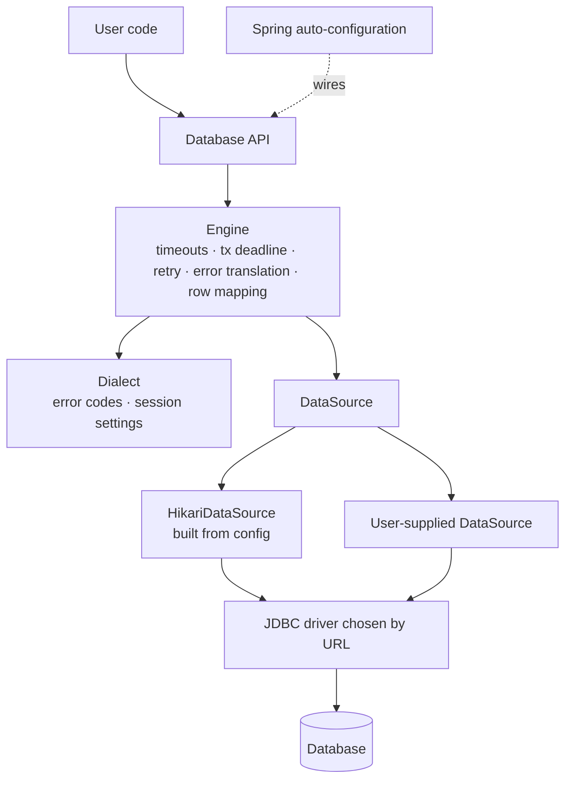
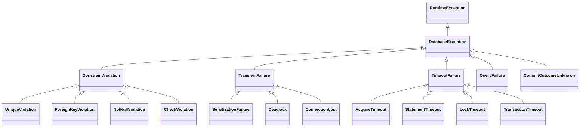

# plugkit-db design

This document records the decisions for plugkit-db.

## 1. Scope

| In scope | Out of scope |
|---|---|
| Relational databases over JDBC | NoSQL stores |
| Plain SQL with named parameters | ORM, entity mapping, query generation |
| Connection pool with safe defaults | Schema migrations (use Flyway or Liquibase) |
| Timeouts, error translation, transaction retry | Cloud authentication code (vendor drivers handle it) |
| PostgreSQL first | Other databases, until a dialect ships |

## 2. Artifact

plugkit-db ships as **one artifact**, `io.github.varnit-ta:plugkit-db`. It contains the API, the
engine, every dialect and the Spring auto-configuration.

| Dependency | Scope | Why |
|---|---|---|
| HikariCP, SLF4J API | compile | Pool and logging API |
| Spring Boot (`spring-boot-autoconfigure`, `spring-boot-health`), `spring-jdbc` | optional | Auto-configuration activates only when they are on the classpath |
| Micrometer | optional | Used only by `MeteredDatabases` and the Spring integration |
| Lombok | provided | Compile-time builders; not on the user's classpath |
| PostgreSQL JDBC driver | optional | Compiled against, to read constraint names from `PSQLException`; only touched when `type` is `postgres` |
| JDBC driver | not included | The user adds the driver for their database |

- **Dialects are bundled.** A dialect only maps error codes and session settings and needs no driver
  classes, so including all of them costs a few KB.
- **Drivers are not bundled.** Shipping every driver would add about 10 MB, force each driver's
  license on every user, and tie driver security patches to plugkit releases.
- **Works without Spring.** Nothing outside the `spring` package imports Spring. Non-Spring
  applications call `Databases.create(...)`, and the Spring classes are never loaded.
- **Spring Boot 4 is the supported generation.** A single artifact can only target one Boot
  generation, because Boot 4 moved some auto-configuration classes. If another generation needs
  support, the `spring` package is split into its own artifact.

## 3. Architecture



## 4. Connections

- **DataSource-first.** The engine only ever calls `DataSource.getConnection()`.
- **Built from config.** `Databases.create(DatabaseConfig)` builds a `HikariDataSource` with the
  defaults in [section 5](#5-configuration).
- **Bring your own.** `Databases.create(DataSource)` uses an existing pool as it is. The database
  type is read from a connection's metadata URL, and the pool name from Hikari when the pool is a
  `HikariDataSource`. plugkit-db can't apply its session and driver settings to a pool it didn't
  build, so only the engine-level watchdogs (transaction deadline, per-statement query timeout) apply.
  Closing the `Database` leaves the pool open.
- **Cloud agnostic through drivers.** Cloud authentication, failover and TLS come from the vendor's
  JDBC driver or plugin, configured through the URL and `driverProperties`. plugkit-db has no
  cloud-specific code.

| Environment | URL / properties |
|---|---|
| Self-hosted | `jdbc:postgresql://host:5432/db` |
| AWS RDS/Aurora with IAM | `jdbc:aws-wrapper:postgresql://...` + `wrapperPlugins=iam,failover` + `software.amazon.jdbc:aws-advanced-jdbc-wrapper` |
| GCP Cloud SQL | `socketFactory=com.google.cloud.sql.postgres.SocketFactory`, `cloudSqlInstance=...` + Cloud SQL socket factory JAR |
| Azure | `sslmode=require` + `azure-identity-extensions` auth plugin |

Hikari types never appear in the public API.

## 5. Configuration

### Settings and defaults

| Key | Default | Applied by |
|---|---|---|
| `type` | inferred from `url` | Dialect selection |
| `url`, `user`, `password` | — (`url` required) | Driver |
| `poolName` | `plugkit-db` | Hikari, logs, metrics |
| `pool.maxSize` | 10 | Hikari |
| `pool.minIdle` | = `pool.maxSize` | Hikari |
| `pool.acquireTimeout` | 5s | Hikari |
| `pool.maxLifetime` | 30m | Hikari |
| `pool.idleTimeout` | 10m | Hikari |
| `pool.keepalive` | 2m | Hikari |
| `pool.leakDetection` | 60s | Hikari |
| `session.statementTimeout` | 30s | Dialect (server) |
| `session.lockTimeout` | 10s | Dialect (server) |
| `session.idleInTransactionTimeout` | 60s | Dialect (server) |
| `tx.defaultTimeout` | 60s | Engine |
| `slowQueryThreshold` | 1s | Engine (log only) |
| `driverProperties` | empty | Passed to the driver as-is |

Derived, not configurable:

| Setting | Value |
|---|---|
| Driver `connectTimeout` | 5s |
| Driver `socketTimeout` | `session.statementTimeout` + 5s |

The `socketTimeout` backstop always fires after the server-side statement timeout, so the two can't
contradict each other.

### Database type

`type` is a `DatabaseType` (`postgres`). It's optional:

- **Not set:** inferred from the URL's sub-protocol. Wrapper prefixes are skipped, so
  `jdbc:aws-wrapper:postgresql:` and `jdbc:otel:postgresql:` both resolve to `postgres`.
- **Set:** it must match the URL, otherwise startup fails:
  `type is 'postgres' but url does not start with jdbc:postgresql:`.

After construction, `DatabaseConfig.type()` is never null.

Not exposed: `autoCommit` (the engine manages transactions), isolation (set per transaction), test
queries, and all other Hikari internals. Anyone who needs those supplies their own `DataSource`.

Long-running work, such as reports, raises timeouts per transaction (`TxOptions`) or per method
(`@Timeouts`) instead of loosening the global defaults.

### Validation

Invalid configuration fails at startup with `InvalidConfigException`. Each config record validates
itself when constructed, and lists all of its problems at once, each naming the key, the limit and
the actual value:

- `url` missing, not starting with `jdbc:`, or not for a supported database
- `type` set but not matching the URL
- `poolName` blank; driver property with a blank key or a null value
- `pool.maxSize < 1`; `pool.minIdle` outside `0..pool.maxSize`
- any `session.*`, `tx.*` or `slowQueryThreshold` duration below 1ms
- pool durations below HikariCP's own minimums, which Hikari would otherwise silently change:

| Key | Minimum | Must also be |
|---|---|---|
| `pool.acquireTimeout` | 250ms | — |
| `pool.maxLifetime` | 30s | — |
| `pool.idleTimeout` | 10s | less than `pool.maxLifetime` |
| `pool.keepalive` | 30s | less than `pool.maxLifetime` |
| `pool.leakDetection` | 2s | less than `pool.maxLifetime` |

### Startup checks

1. Before building the pool, plugkit-db checks that the JDBC driver for `type` is on the classpath.
   If it isn't, startup fails with `InvalidConfigException`:
   `type 'postgres' needs the JDBC driver org.postgresql.Driver: add the dependency org.postgresql:postgresql`.
2. Hikari opens the first connection while the pool starts. If that fails, the driver's error is
   translated by the dialect and thrown, for example `ConnectionLost` for an unreachable host
   (bounded by the 5s connect timeout) or `QueryFailure` with SQLState `28P01` for a wrong password.
   The pool is not created.
3. It reads `max_connections` (`dialect.maxConnectionsQuery()`) and logs a warning if
   `pool.maxSize` is more than 50% of it. If the value can't be read, the check is skipped.

### Secrets

`DatabaseConfig.toString()` masks `password`, any driver property whose key contains `password`,
`secret` or `token`, the same keys in URL query parameters, and the password in `user:password@host`.

## 6. Dialects

```java
public interface Dialect {
    DatabaseType type();
    String driverClassName();
    String driverArtifact();
    Map<String, String> connectionProperties(SessionConfig session, Map<String, String> userProperties);
    String maxConnectionsQuery();
    String localStatementTimeoutSql(Duration statementTimeout);
    DatabaseException translate(SQLException exception, String poolName);
}
```

- Dialects are internal and bundled. `Dialects.forType(DatabaseType)` maps each type to its dialect
  with an exhaustive `switch`, so adding a `DatabaseType` constant fails to compile until a dialect
  is registered. There is no runtime discovery.
- Adding a database means adding a `DatabaseType` constant, a dialect in
  `io.github.varnitta.plugkit.db.internal.dialect.<name>`, and its `switch` case.
- `connectionProperties` merges the user's `driverProperties` with the properties plugkit-db
  manages, and rejects user values for managed keys.
- When a second dialect ships: a `DialectContractTest` suite every dialect must pass, and a way for
  a dialect to report session settings it can't enforce (logged as a startup warning).

### PostgreSQL connection properties

| Property | Value | Source |
|---|---|---|
| `connectTimeout` | `5` (seconds) | managed; user value rejected |
| `socketTimeout` | `session.statementTimeout` + 5s, rounded up to seconds | managed; user value rejected |
| `logServerErrorDetail` | `false` | default; user may override |
| `options` | `-c statement_timeout=… -c lock_timeout=… -c idle_in_transaction_session_timeout=…` | managed; a user `options` value is appended after it |

Session settings travel in `options`, so they're applied at login with no extra round trip.
`logServerErrorDetail=false` keeps the server's `DETAIL` text, which contains row values such as
`Key (email)=(alice@example.com)`, out of driver exception messages and logs.

## 7. Public API

```java
public interface SqlOperations {
    <T> List<T> query(String sql, Params params, RowMapper<T> mapper);
    <T> Optional<T> queryOne(String sql, Params params, RowMapper<T> mapper);
    int update(String sql, Params params);
    int[] batch(String sql, List<Params> rows);
}

public interface Database extends SqlOperations, AutoCloseable {
    <T> T inTransaction(TxOptions options, Function<Transaction, T> work);
    default <T> T inTransaction(Function<Transaction, T> work) { }
    DatabaseType type();
    String poolName();
    Health health();
    void close();
}

public interface Transaction extends SqlOperations {
}

@FunctionalInterface
public interface RowMapper<T> {
    T map(Row row);
}

public final class Databases {
    public static Database create(DatabaseConfig config) { }
    public static Database create(DataSource dataSource) { }
}
```

- `Database` is thread-safe. `Transaction` is bound to one thread and is only valid inside its callback.

### Parameters

- SQL uses named parameters (`:id`). The API never builds SQL from string fragments.
- `Params.of("id", 42).and("status", "OPEN")`. Values may be `null`. Names must be identifiers and
  can't repeat. `toString()` shows names only, never values.
- The parser skips string literals, quoted identifiers, `--` and `/* */` comments, dollar-quoted
  text (`$$ … $$`, `$tag$ … $tag$`) and `::` casts.
- A `Collection` value expands for `IN` lists: `in (:ids)` → `in (?, ?, ?)`. An empty collection is
  rejected. Arrays bind as one value (for `= any(:ids)`).
- `Instant` binds as a UTC `OffsetDateTime`; enums bind as `name()`; everything else goes to
  `setObject`.
- A parameter in the SQL with no value throws `IllegalArgumentException` listing the given names.
  Extra values are ignored, so one `Params` can serve several statements.

### Rows

- `RowMapper<T>` maps one `Row`. A `Row` is only valid inside the mapper call.
- Typed getters (`getString`, `getLong`, `getInt`, `getBoolean`, `getBigDecimal`, `getInstant`,
  `getLocalDate`, `getUuid`) and `get(column, Class)` return `null` for SQL `NULL`.
- `require(column, Class)` returns a non-null value or throws `QueryFailure` naming the column.

### Statements

| Method | Behaviour |
|---|---|
| `query` | All rows, mapped |
| `queryOne` | `Optional` of zero or one row; more than one throws `QueryFailure`. Fetches at most two rows. Works with `insert … returning` |
| `update` | Row count; also for DDL |
| `batch` | One prepared statement; returns per-row counts. On `Database` it runs in its own transaction, so it's atomic; inside a `Transaction` it joins that transaction. Every row must expand to the same SQL. An empty list does nothing |

- Outside a transaction each call borrows a connection, runs in auto-commit and returns it.
- Pool exhausted: `AcquireTimeout` with pool stats and the fix, for example
  `No connection available within 300 ms [pool=orders, active=1, idle=0, waiting=0]. Increase pool.maxSize, …`.
  If the pool couldn't create a connection at all, the driver's error is translated instead.
- Batch failures: pgjdbc's `BatchUpdateException` message contains the SQL with bound values, so
  the dialect classifies the error and builds the message from the underlying server error instead.

## 8. Transactions

```java
db.inTransaction(TxOptions.builder().isolation(Isolation.SERIALIZABLE).maxAttempts(3).build(), tx -> {
    tx.update("update accounts set balance = balance - :amt where id = :id", debit);
    tx.update("update accounts set balance = balance + :amt where id = :id", credit);
    return null;
});
```

| Option | Default | Notes |
|---|---|---|
| `isolation` | database default (Postgres: READ COMMITTED) | `READ_COMMITTED`, `REPEATABLE_READ`, `SERIALIZABLE` |
| `readOnly` | false | Writes fail with `QueryFailure` (Postgres SQLState `25006`) |
| `timeout` | `tx.defaultTimeout` (60s) | Deadline for the whole transaction |
| `statementTimeout` | `session.statementTimeout` (30s) | Applied with `set local statement_timeout` when set |
| `maxAttempts` | 1 (no retry) | 1 to 10 |

**Lifecycle.** Borrow a connection, `setAutoCommit(false)`, apply isolation, read-only and the
statement timeout, run the callback, commit. Any exception rolls back and is rethrown unchanged.
Hikari restores auto-commit, isolation, read-only and the network timeout when the connection
returns to the pool; `set local` ends with the transaction.

**Deadline.** When a transaction starts, the engine records its deadline. Before each statement it
sets the JDBC query timeout to `min(time left, statementTimeout)`, rounded up to whole seconds
(JDBC's unit). A statement cancelled after the deadline passed becomes `TransactionTimeout`; a
statement started after it fails immediately without reaching the database. The deadline is checked
again before commit, so a callback that overran rolls back.

**Network timeout.** The connection-level `socketTimeout` follows the global statement timeout. When a
transaction raises `statementTimeout` (through `TxOptions` or `@Timeouts`), the engine also raises the
connection's network timeout with `Connection.setNetworkTimeout` to the new statement timeout plus 5s.
Otherwise the socket backstop would cut long statements short. Hikari restores the value when the
connection returns to the pool.

**Retry.** Retry is opt-in (`maxAttempts > 1`), because the callback may have side effects. On a
`TransientFailure`, including a serialization failure raised at commit, the engine rolls back, waits,
and reruns the whole callback in a new transaction with a fresh deadline. The wait before retry `n`
is random between 0 and `min(2s, 50ms × 2^(n-1))` (full jitter). Single statements are never retried
on their own; other exceptions are never retried.

**Joined transactions.** When the connection already belongs to a transaction managed elsewhere
(Spring, see section 11), the callback joins it instead of starting its own.

**Escaped transactions.** A `Transaction` used after its callback returns throws
`IllegalStateException`. Calling `db.inTransaction` inside a callback opens a separate transaction on
another connection.

**Commit outcome.** If the connection is lost while the commit is in flight, the engine throws
`CommitOutcomeUnknown` and never retries, because the commit may have succeeded.

## 9. Errors

All exceptions are unchecked and keep the original `SQLException` as the cause. Every
`DatabaseException` offers `sqlState()` and `isRetryable()`, which is `true` only for
`TransientFailure`. Base and category classes can't be subclassed outside the library; leaf classes
are `final`.



| Exception | PostgreSQL | Retryable |
|---|---|---|
| `UniqueViolation` | `23505` | no |
| `ForeignKeyViolation` | `23503` | no |
| `NotNullViolation` | `23502` | no |
| `CheckViolation` | `23514` | no |
| `SerializationFailure` | `40001` | yes |
| `Deadlock` | `40P01` | yes |
| `ConnectionLost` | `08xxx`, `57P01`–`57P03` (server shutdown / not accepting connections), outside commit | yes |
| `StatementTimeout` | `57014` | no |
| `LockTimeout` | `55P03` | no |
| `AcquireTimeout` | Hikari `SQLTransientConnectionException` | no |
| `TransactionTimeout` | engine deadline, `25P03` (idle-in-transaction timeout) | no |
| `QueryFailure` | everything else, including a missing SQLState | no |

Constraint exceptions expose the constraint name when the database provides it. The message is the
server's primary error text plus `[SQLState …]`. It never includes the server's `DETAIL`, so row and
parameter values don't appear. The engine adds the pool name.

## 10. Watchdogs

| Layer | Watchdog | Setting |
|---|---|---|
| Pool | Wait for a connection | `pool.acquireTimeout` |
| Pool | Leaked connection (logs the borrower's stack trace) | `pool.leakDetection` |
| Pool | Idle socket keepalive, connection retirement | `pool.keepalive`, `pool.maxLifetime` |
| Driver | Connect, dead network during a query | derived `connectTimeout`, `socketTimeout` |
| Server | Statement, lock wait, idle in transaction | `session.*` |
| Engine | Whole-transaction deadline | `tx.defaultTimeout`, `TxOptions.timeout` |
| Engine | Slow-query log (WARN, SQL text without parameters) | `slowQueryThreshold` |

## 11. Spring integration

Spring Boot 4 support lives in the same artifact and activates only when Spring Boot and
`spring-jdbc` are on the classpath. Three auto-configurations are registered in
`META-INF/spring/org.springframework.boot.autoconfigure.AutoConfiguration.imports`.

```yaml
plugkit:
  db:
    url: jdbc:postgresql://localhost:5432/app
    user: app
    password: ${DB_PASSWORD}
    pool:
      max-size: 20
    session:
      statement-timeout: 10s
    driver-properties:
      sslmode: require
```

```java
@Service
class OrderService {
    private final Database db;
    OrderService(Database db) { this.db = db; }
}
```

### Modes

| Situation | What plugkit-db does |
|---|---|
| `plugkit.db.url` set | Builds its own pool from `plugkit.db.*` and registers it as the application's `DataSource` bean (unless one exists). Runs before Boot's DataSource auto-configuration, which backs off, so Boot's transaction manager, `@Transactional` and Flyway all use the same pool |
| No `plugkit.db.url`, one `DataSource` bean (from `spring.datasource.*` or the application) | Wraps that pool with `Databases.create(DataSource)`. Runs after Boot's DataSource auto-configuration. The pool keeps its own settings and is closed by Spring, not by plugkit-db |
| Neither | No `Database` bean |

- `@ConfigurationProperties("plugkit.db")` is a record mapped one-to-one onto `DatabaseConfig`;
  unset values use the same defaults. Metadata for IDE autocomplete is generated.
- Every bean is `@ConditionalOnMissingBean`, so an application can define its own.

### Joining Spring transactions

Statements get their connection through Spring's `DataSourceUtils`. Inside a Spring transaction on
the same `DataSource`, they use Spring's connection and transaction:

- `query`, `update` and `batch` run inside the Spring transaction.
- `inTransaction` joins it: no begin, commit, rollback or retry; isolation and read-only come from
  `@Transactional`. A thrown exception rolls back the whole Spring transaction, as Spring decides.
- Outside a Spring transaction, everything behaves as without Spring.
- `@Transactional(readOnly = true)` is the read-only/replica hint; it calls `setReadOnly(true)`,
  which vendor plugins such as the AWS wrapper use for read/write splitting.
- `@Transactional(timeout = …)` isn't applied to plugkit-db statements; use `@Timeouts`.

### Annotations

| Annotation | Behaviour |
|---|---|
| `@RetryOnTransient(maxAttempts = 3)` | Reruns the method after a transient failure: a retryable plugkit-db exception, or Spring's `TransientDataAccessException` (which Spring's transaction manager throws for failures at commit). Backoff as in section 8. Not applied when a transaction is already active, because only the outermost transaction can be rerun |
| `@Timeouts(statement = "5m", transaction = "10m")` | Overrides plugkit-db's statement and transaction timeouts while the method runs. Values use Spring Boot's duration format; empty keeps the default |

```java
@RetryOnTransient(maxAttempts = 3)
@Transactional
public void transfer(long from, long to, BigDecimal amount) { }

@Timeouts(statement = "5m")
@Transactional(readOnly = true)
public Report monthlyReport(YearMonth month) { }
```

- Both work on methods and classes, and are implemented as Spring AOP advisors. The retry advisor is
  ordered outside Spring's transaction advisor, so each attempt runs in a fresh transaction. If the
  application has no auto-proxy creator, one with class proxying is registered.
- `@Timeouts` sets per-thread overrides. Inside a transaction the statement timeout is applied with
  `set local statement_timeout` and the network timeout is raised. Statements outside a transaction
  run in their own short transaction so the limit can be applied.

### Other beans

- **Metrics:** if Micrometer and a `MeterRegistry` bean exist, metrics are recorded (section 12).
- **Health:** `plugkitDbHealthIndicator` reports `Database.health()` as `plugkitDb`, with the
  database type, pool name, response time and, when down, the problem.

## 12. Observability

- **Logging:** SLF4J API only. INFO for pool start and stop and for retries; WARN for startup checks
  and slow queries; per-query logging only at DEBUG. Parameter values are never logged.
- **Metrics:** `MeteredDatabases.create(config, meterRegistry)` (or the Spring integration) records
  to Micrometer. `Databases.create(...)` records nothing. Only `MeteredDatabases` and an internal
  recorder reference Micrometer, so applications without it never load Micrometer classes.

| Metric | Type | Tags |
|---|---|---|
| `plugkit.db.statement` | timer, per statement including waiting for a connection | `pool`, `operation` (`query`, `queryOne`, `update`, `batch`), `outcome` |
| `plugkit.db.transaction` | timer, per transaction attempt | `pool`, `outcome` |
| `plugkit.db.transaction.retries` | counter | `pool`, `reason` |
| `hikaricp.*` | HikariCP's pool gauges and timers, for pools plugkit-db builds | `pool` |

`outcome` is `success`, the `DatabaseException` type (for example `UniqueViolation`), or
`application_error` for any other exception. The tag values come from a fixed set, so they don't
grow without bound. For a wrapped pool, plugkit-db doesn't register `hikaricp.*` meters; Spring Boot
already does for its own pools.

- **Health:** `Database.health()` borrows a connection and calls the driver's `isValid` (2s limit). It
  returns `Health(healthy, responseTime, problem)` and never throws; a closed pool or an unreachable
  database is reported as unhealthy with the translated error message.

## 13. Library practices

- **Packages:** each package has one job. `module-info.java` exports only the public ones.

The public API is grouped by feature; everything under `internal` is implementation and isn't
exported, so applications can't depend on it. The same pattern is used by OkHttp
(`okhttp3.internal.*`) and JDBI (`core.internal`). Tests mirror the main packages.

```
io.github.varnitta.plugkit.db
├── Database, Databases, DatabaseType, Health    entry points
├── config/        DatabaseConfig, PoolConfig, SessionConfig, TxConfig
├── sql/           SqlOperations, Params, Row, RowMapper
├── tx/            Transaction, TxOptions, Isolation
├── exception/     DatabaseException hierarchy, InvalidConfigException
├── metrics/       MeteredDatabases (the only public class that uses Micrometer)
├── spring/        PlugkitDbProperties, @RetryOnTransient, @Timeouts
└── internal/      not exported
    ├── connection/    ConnectionProvider, DataSourceConnectionProvider
    ├── metrics/       MetricsRecorder, MicrometerMetricsRecorder
    ├── pool/          PooledDatabase, HikariPoolFactory, DriverCheck
    ├── statement/     StatementExecutor, NamedSql, ResultSetRow, UncheckedSqlException
    ├── tx/            TransactionRunner, ConnectionTransaction, Backoff, TimeoutOverrides
    ├── spring/        auto-configurations, SpringConnectionProvider, interceptors, health indicator
    ├── validation/    ConfigValidator
    └── dialect/       Dialect, Dialects
        └── postgres/  PostgresDialect
```

- **Exceptions stay in one package.** Applications catch them everywhere, so one import location
  keeps that simple.
- **Internal visibility:** classes used across `internal` subpackages are `public`; `module-info`
  still hides them.
- **`UncheckedSqlException`** carries a `SQLException` out of a `RowMapper`, which can't throw checked
  exceptions. The engine always catches and translates it, so it never reaches applications.
- **Boundaries:** only `spring` imports Spring; only `internal.dialect.<name>` contains
  database-specific code. A test enforces this, so the artifact can be split later by moving packages.
- **Types:** classes are `final` unless they are an extension point. The module is `@NullMarked`
  (JSpecify) in `module-info.java`, which covers every package; there are no `package-info.java` files.
- **Config records:** record components are non-null (except `user` and `password`); the compact
  constructor validates. Lombok `@Builder` sits on a private static factory whose parameters are
  `@Nullable`; an unset builder value is `null`, and the factory replaces it with the default before
  calling the constructor.
- **Dependencies:** see [section 2](#2-artifact). The Maven enforcer checks `dependencyConvergence`.
- **Lifecycle:** no static state apart from the per-thread `@Timeouts` overrides, which are always
  restored when the method returns. Each `Database` owns its pool unless it wraps one. `close()` stops new work, waits
  for in-flight work up to a timeout, then closes the pool.
- **Virtual threads:** blocking paths use `ReentrantLock`, not `synchronized`.
- **Compatibility:** semantic versioning. Removals follow at least one minor release of
  `@Deprecated(forRemoval = true)`.

## 14. Testing

| Kind | Tooling | Covers |
|---|---|---|
| Unit | JUnit 5 | Config validation, parameter binding, row mapping, error translation, secret masking |
| Integration (`*IT`) | Testcontainers PostgreSQL, failsafe; skipped when Docker is unavailable | Pool startup, session settings, startup failures, queries, transactions, timeouts, retry, metrics, wrapped pools |
| Spring (`SpringIntegrationIT`) | `ApplicationContextRunner` with Boot's JDBC and transaction auto-configuration | Both modes, joining `@Transactional`, `@RetryOnTransient`, `@Timeouts`, health, metrics |
| Contract | `DialectContractTest` | Behaviour every dialect must meet |
| Failure | Testcontainers Toxiproxy | Network loss, latency, connection kill mid-transaction, pool recovery |

## 15. Deferred

| Item | Note |
|---|---|
| `@AdvisoryLock` | Single-instance execution using Postgres advisory locks |
| Other dialects | MySQL, SQL Server |
| JMH overhead benchmarks | Compare plugkit-db against raw JDBC |
| API compatibility check | `japicmp` in CI before 1.0 |
