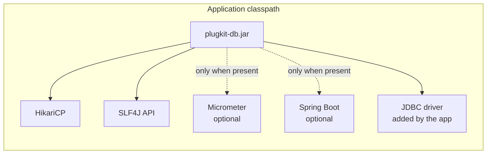
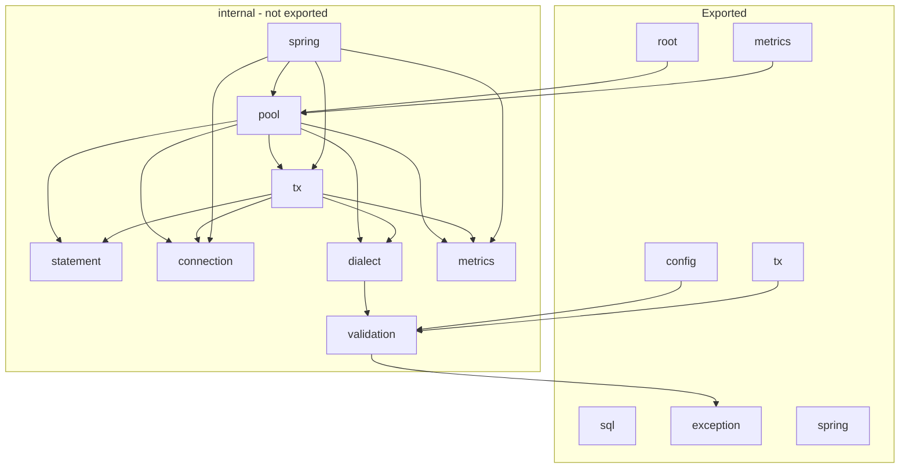
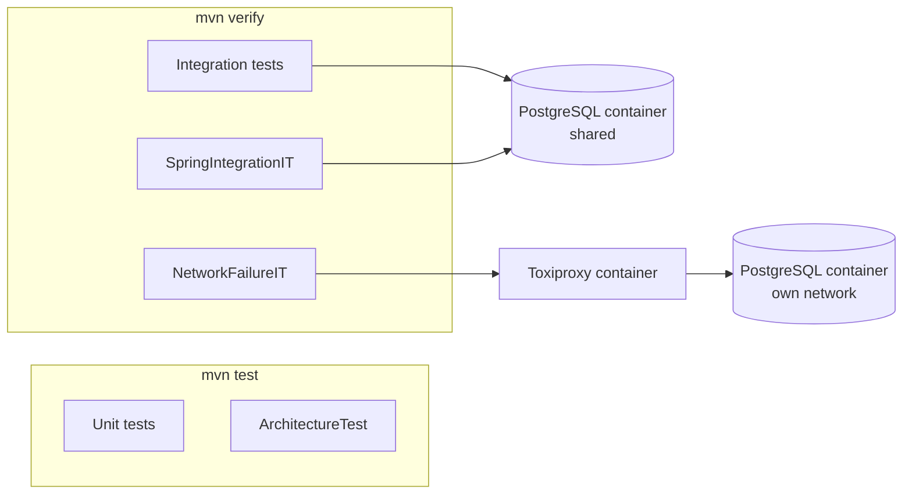

# ADR-0001: Architecture and structure

- Status: Accepted
- Date: 2026-11-08

How plugkit-db is packaged and organised, and how that structure is kept.

1. [Record architecture decisions](#1-record-architecture-decisions)
2. [One artifact with optional integrations](#2-one-artifact-with-optional-integrations)
3. [Feature packages with a private `internal` tree](#3-feature-packages-with-a-private-internal-tree)
4. [Testing strategy](#4-testing-strategy)

## 1. Record architecture decisions

### Context

plugkit-db is a library other teams depend on. Its structure, defaults and boundaries are deliberate,
and a contributor needs to know why things are the way they are before changing them. A single design
document mixed decisions, rationale and reference material, and grew hard to keep accurate.

### Decision

Architecture decisions for plugkit-db are recorded as Architecture Decision Records in
`plugkit-db/docs/adr/`. Related decisions are grouped into one ADR per question a reader has (how is
it structured, how is it configured, how do databases plug in, how does SQL run, how does it
integrate), so there are a few ADRs rather than one per topic.

Each ADR is split into numbered parts, and each part has:

| Section | Content |
|---|---|
| Context | The forces and constraints that led to the decision |
| Decision | What was decided |
| Structure | The classes, packages and flows the decision produced, with diagrams |
| Consequences | What becomes easier, what becomes harder, and what is left for later |

The ADR carries one status: `Proposed`, `Accepted`, `Superseded by ADR-NNNN` or `Deprecated`.

Rules:

- A new decision that belongs to an existing question becomes a new part of that ADR. A new question
  becomes a new ADR.
- A decision is not rewritten to reverse it. The part is marked superseded and points to the part that
  replaces it.
- Small corrections that keep an ADR accurate to the code (a renamed class, a changed default) are
  edited in place.
- Cross-references link to a part: "ADR-0003 part 1".
- Diagrams use Mermaid so they render on GitHub and stay editable as text.

### Consequences

- Five ADRs cover the whole library; each can be read on its own.
- The [index](README.md) is the entry point; it lists the ADRs and their parts, and maps each package
  to the part that explains it.
- Code changes that alter a decision must come with an ADR change in the same pull request.

## 2. One artifact with optional integrations

### Context

plugkit-db should be plug and play: one dependency, a few connection settings, and a working
database client. It has to support several databases over time, work with and without Spring Boot,
and record metrics only for applications that use Micrometer.

Two packaging styles are common:

| Style | Example | Trade-off |
|---|---|---|
| One artifact per database and integration | Flyway 10+ (`flyway-database-postgresql`), Resilience4j (`-spring-boot3`) | Users pick several artifacts; versions must line up |
| One artifact, optional dependencies | jOOQ (all dialects), Spring Boot autoconfigure | One dependency; only one Spring Boot generation per release |

Database support in plugkit-db needs no driver classes for its core job (error codes and session
settings are plain strings), so bundling every dialect costs a few KB.

### Decision

plugkit-db ships as **one artifact**, `io.github.varnit-ta:plugkit-db`, containing the API, the engine,
every dialect, Micrometer support and Spring Boot support.

| Dependency | Scope | Why |
|---|---|---|
| HikariCP, SLF4J API | compile | Connection pool and logging API |
| JSpecify | compile | Nullness annotations on the public API |
| Lombok | provided | Compile-time builders; not on the user's classpath |
| PostgreSQL JDBC driver | optional | Compiled against to read constraint names; touched only when `type` is `postgres` |
| Micrometer | optional | Used only by `MeteredDatabases` and the Spring integration |
| `spring-boot-autoconfigure`, `spring-boot-health`, `spring-jdbc` | optional | Auto-configuration activates only when present |
| JDBC driver for the user's database | not included | The application adds it |

- **Drivers are not bundled.** Bundling every driver would add about 10 MB, force each driver's
  license on every user, and tie driver security patches to plugkit releases. A missing driver fails at
  startup with the dependency to add ([ADR-0002 part 1](0002-connections-configuration-and-lifecycle.md#1-datasource-first-connections-cloud-support-through-drivers)).
- **Spring Boot 4 is the supported generation.** One artifact can only target one Boot generation,
  because Boot 4 moved auto-configuration classes between modules. If another generation is needed,
  the `spring` packages split into their own artifact; [part 3](#3-feature-packages-with-a-private-internal-tree) keeps that
  split mechanical.
- **Optional integrations are isolated.** Only `metrics`, `spring` and their `internal` counterparts
  reference Micrometer or Spring, enforced by `ArchitectureTest`
  ([part 4](#4-testing-strategy)). An application without them never loads their classes.

#### Scope

| In scope | Out of scope |
|---|---|
| Relational databases over JDBC | NoSQL stores |
| Plain SQL with named parameters | ORM, entity mapping, query generation |
| Connection pool with safe defaults | Schema migrations (use Flyway or Liquibase) |
| Timeouts, error translation, transaction retry | Cloud authentication code (vendor drivers handle it) |
| PostgreSQL first | Other databases until their dialect ships |

### Structure



Published artifacts per release: `plugkit-db.jar`, `plugkit-db-sources.jar` and `plugkit-db-javadoc.jar`.
The parent POM enforces Maven 3.9+, Java 21+ and dependency convergence.

### Consequences

- Users add one dependency and their driver.
- A future database is a new dialect inside the same artifact, not a new artifact
  ([ADR-0003 part 1](0003-multi-database-support.md#1-dialect-adapters-and-a-factory-for-multiple-databases)).
- Supporting a second Spring Boot generation would require splitting the Spring packages out.
- A dialect that later needs heavy driver-specific code (for example PostgreSQL `COPY`) can move that
  one feature into a small add-on artifact while basic support stays bundled.

## 3. Feature packages with a private `internal` tree

### Context

Anything public in a library becomes something users depend on. When implementation classes are
reachable, applications start using them and those classes can no longer change. HikariCP, for example,
exports `com.zaxxer.hikari.pool`, so applications can depend on its pool internals.

Libraries that avoid this group their public API by feature and keep implementation in an `internal`
package: OkHttp (`okhttp3.internal.connection`, `.http`, `.cache`), JDBI (`core.internal`),
Micrometer (`instrument.internal`), Netty (`util.internal`) and the JDK (`jdk.internal.*`).

### Decision

- The public API is grouped by feature. Everything under `internal` is implementation.
- `module-info.java` exports only the public packages, so the Java module system hides `internal`
  from applications on the module path. On the class path, the package name tells users it is private.
- The module is `@NullMarked` (JSpecify) in `module-info.java`; everything is non-null unless
  annotated `@Nullable`. There are no `package-info.java` files.
- Classes used across `internal` subpackages are `public` but stay hidden because `internal` isn't
  exported.
- Exceptions stay in one package, because applications catch them everywhere.
- Tests mirror the main packages.
- Every Java type has class-level Javadoc. Code has no inline comments.

### Structure

```
io.github.varnitta.plugkit.db                 exported
├── Database, Databases, DatabaseType, Health     entry points
├── config/        DatabaseConfig, PoolConfig, SessionConfig, TxConfig
├── sql/           SqlOperations, Params, Row, RowMapper
├── tx/            Transaction, TxOptions, Isolation
├── exception/     DatabaseException hierarchy, InvalidConfigException
├── metrics/       MeteredDatabases
├── spring/        PlugkitDbProperties, @RetryOnTransient, @Timeouts
└── internal/                                     not exported
    ├── connection/    ConnectionProvider, DataSourceConnectionProvider
    ├── dialect/       Dialect, Dialects
    │   └── postgres/  PostgresDialect
    ├── metrics/       MetricsRecorder, MicrometerMetricsRecorder
    ├── pool/          PooledDatabase, HikariPoolFactory, DriverCheck, InFlightTracker
    ├── spring/        auto-configurations, SpringConnectionProvider, interceptors,
    │                  DatabaseHealthIndicator, AnnotationLookup
    ├── statement/     StatementExecutor, NamedSql, ResultSetRow, UncheckedSqlException
    ├── tx/            TransactionRunner, ConnectionTransaction, Backoff, TimeoutOverrides
    └── validation/    ConfigValidator
```

| Package | Role | Explained in |
|---|---|---|
| root | `Databases` creates a `Database`; `DatabaseType` names supported databases; `Health` reports checks | [ADR-0002 part 1](0002-connections-configuration-and-lifecycle.md#1-datasource-first-connections-cloud-support-through-drivers), [ADR-0003 part 1](0003-multi-database-support.md#1-dialect-adapters-and-a-factory-for-multiple-databases), [ADR-0005 part 2](0005-integrations.md#2-logging-metrics-and-health) |
| `config` | Immutable, validated configuration | [ADR-0002 part 2](0002-connections-configuration-and-lifecycle.md#2-immutable-validated-configuration-with-safe-defaults) |
| `sql` | Statements, parameters and row mapping | [ADR-0004 part 1](0004-running-sql.md#1-plain-sql-with-named-parameters-and-row-mappers) |
| `tx` | Transactions and their options | [ADR-0004 part 2](0004-running-sql.md#2-transactions-with-deadlines-opt-in-retry-and-safe-commits) |
| `exception` | Vendor-neutral errors | [ADR-0003 part 2](0003-multi-database-support.md#2-vendor-neutral-error-model) |
| `metrics` | Micrometer entry point | [ADR-0005 part 1](0005-integrations.md#1-integration-adapters-and-factories), [ADR-0005 part 2](0005-integrations.md#2-logging-metrics-and-health) |
| `spring` | Spring Boot properties and annotations | [ADR-0005 part 3](0005-integrations.md#3-spring-boot-4-integration) |
| `internal.connection` | Where statements get connections | [ADR-0005 part 1](0005-integrations.md#1-integration-adapters-and-factories) |
| `internal.dialect` | Database adapters and their factory | [ADR-0003 part 1](0003-multi-database-support.md#1-dialect-adapters-and-a-factory-for-multiple-databases) |
| `internal.metrics` | Metrics adapters | [ADR-0005 part 1](0005-integrations.md#1-integration-adapters-and-factories) |
| `internal.pool` | The `Database` implementation, pool building, shutdown | [ADR-0002 part 1](0002-connections-configuration-and-lifecycle.md#1-datasource-first-connections-cloud-support-through-drivers), [ADR-0002 part 3](0002-connections-configuration-and-lifecycle.md#3-lifecycle-and-graceful-shutdown) |
| `internal.spring` | Spring adapters and auto-configuration | [ADR-0005 part 3](0005-integrations.md#3-spring-boot-4-integration) |
| `internal.statement` | Statement execution and parameter parsing | [ADR-0004 part 1](0004-running-sql.md#1-plain-sql-with-named-parameters-and-row-mappers) |
| `internal.tx` | Transaction engine | [ADR-0004 part 2](0004-running-sql.md#2-transactions-with-deadlines-opt-in-retry-and-safe-commits) |
| `internal.validation` | Configuration validation helper | [ADR-0002 part 2](0002-connections-configuration-and-lifecycle.md#2-immutable-validated-configuration-with-safe-defaults) |



#### Boundaries enforced by `ArchitectureTest`

| Rule | Why |
|---|---|
| Only `spring` and `internal.spring` use Spring | The core works without Spring |
| Only `metrics`, `internal.metrics` and `internal.spring` use Micrometer | The core works without Micrometer |
| Only `internal.dialect.postgres` uses the PostgreSQL driver | Database-specific code stays in its dialect |
| Only `internal.pool` and `internal.metrics` use HikariCP | The pool can be replaced |
| `exception` depends only on itself, the JDK and JSpecify | Catching an exception pulls in nothing else |
| `config` depends only on `internal.validation` | Configuration stays independent of the engine |
| `internal.*` packages have no cycles | Each internal package can be changed on its own |
| Public methods in exported packages don't use `internal` types | Applications can't reach internals through the API |
| Internal implementation classes are `final` | Nothing outside the library extends them |

### Consequences

- Applications see a small API: about 20 public types outside `exception`.
- Internal classes can be renamed, split or replaced without breaking users.
- Splitting the artifact later (for example the Spring support) means moving packages, not untangling
  code.
- A few internal classes are `public` only for cross-package use; the module system, not the
  `public` keyword, is what hides them.

## 4. Testing strategy

### Context

plugkit-db's value is behaviour under real conditions: actual PostgreSQL error codes, real timeouts,
real Spring transactions and real network faults. Mocks of JDBC or of the database would test our
assumptions, not the behaviour. The package boundaries in [part 3](#3-feature-packages-with-a-private-internal-tree) also
need protection, or they erode with each change.

### Decision

| Kind | Tooling | Runs in | Covers |
|---|---|---|---|
| Unit | JUnit 5, AssertJ | `test` (surefire) | Config validation and defaults, parameter parsing, row mapping, error translation, secret redaction, backoff, commit failure handling with a fake connection, metrics recording, annotation settings, shutdown tracking |
| Architecture | ArchUnit (`ArchitectureTest`) on the compiled classes | `test` | Every boundary rule in part 3 |
| Integration (`*IT`) | Testcontainers PostgreSQL 17 | `verify` (failsafe) | Pool startup and startup failures, session settings, queries, transactions, deadlines, deadlock retry, graceful shutdown, metrics, wrapped pools |
| Spring (`SpringIntegrationIT`) | `ApplicationContextRunner` with Boot's JDBC and transaction auto-configuration | `verify` | Both modes, joining `@Transactional`, `@RetryOnTransient`, `@Timeouts`, health, metrics |
| Failure (`NetworkFailureIT`) | Testcontainers Toxiproxy between plugkit-db and PostgreSQL | `verify` | Real network faults (below) |

Rules:

- Integration tests share one PostgreSQL container (`TestPostgres`) and skip themselves when Docker is
  unavailable (`@Testcontainers(disabledWithoutDocker = true)`).
- Timing-sensitive tests (deadlocks, deadlines, network faults, shutdown) are rerun several times before
  a change is accepted.
- Architecture rules are checked for real violations: a planted violation must fail the test.
- The build runs on Java 21 and 25, as in CI.

#### Network faults

| Fault | Expected behaviour |
|---|---|
| Responses stop arriving mid-query (black hole) | `ConnectionLost` after the derived socket timeout instead of hanging |
| Connection cut mid-transaction, `maxAttempts` 3 | The transaction reruns on a fresh connection and commits exactly once |
| Connection dropped while the commit is in flight | `CommitOutcomeUnknown`; not retried; nothing committed |
| Database unreachable, then back | `health()` reports down with the pool name, queries fail with a `DatabaseException`, and both recover |

### Structure



### Consequences

- Behaviour is verified against a real database, real Spring wiring and real faults.
- `mvn verify` needs Docker; without it, integration tests are skipped rather than failing.
- A `DialectContractTest` that every dialect must pass is added with the second dialect
  ([ADR-0003 part 1](0003-multi-database-support.md#1-dialect-adapters-and-a-factory-for-multiple-databases)).
- Not covered yet: performance benchmarks against raw JDBC (JMH) and binary-compatibility checks
  (`japicmp`), planned before 1.0.
