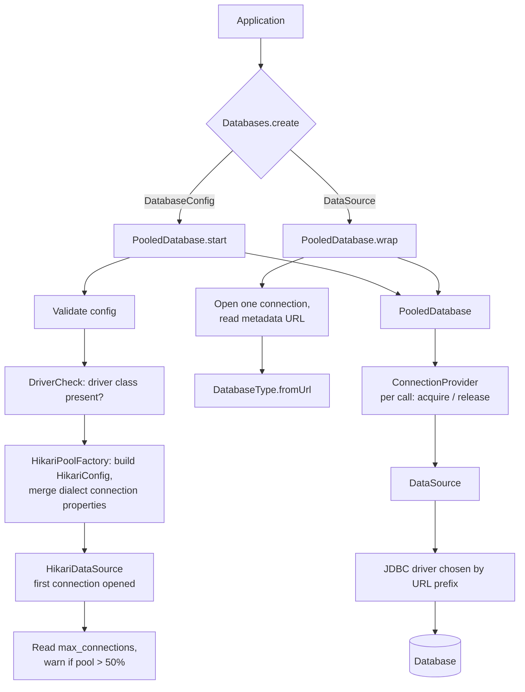
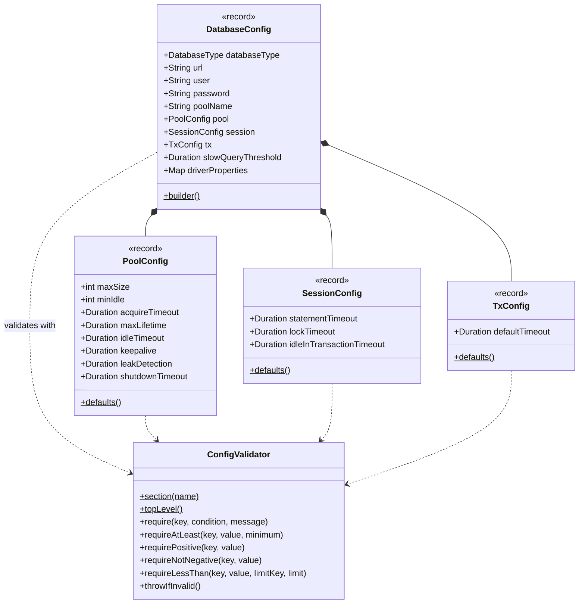
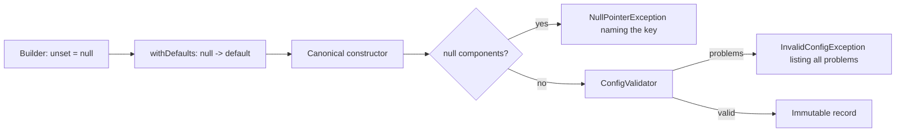
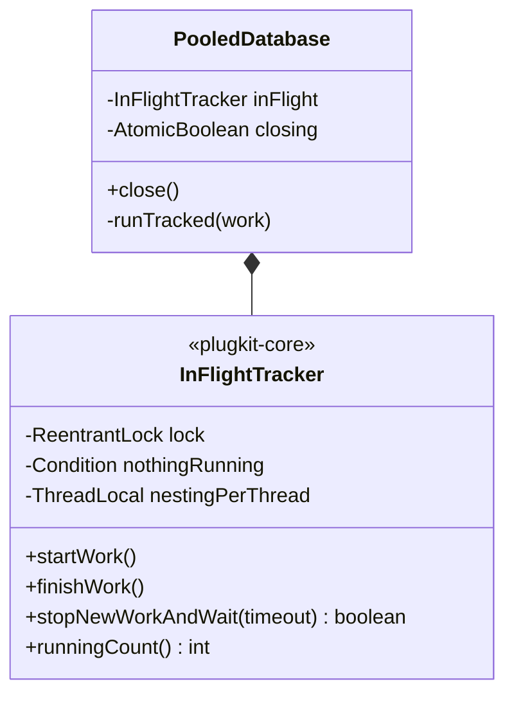
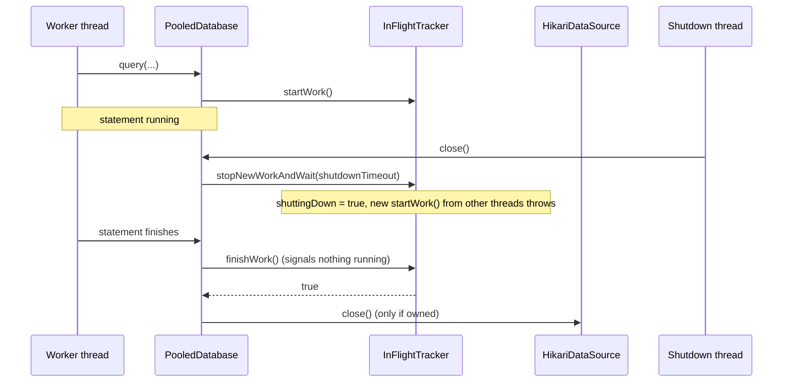

# ADR-0002: Connections, configuration and lifecycle

- Status: Accepted
- Date: 2026-11-08

How a `Database` is created, configured and shut down.

1. [DataSource-first connections, cloud support through drivers](#1-datasource-first-connections-cloud-support-through-drivers)
2. [Immutable, validated configuration with safe defaults](#2-immutable-validated-configuration-with-safe-defaults)
3. [Lifecycle and graceful shutdown](#3-lifecycle-and-graceful-shutdown)

## 1. DataSource-first connections, cloud support through drivers

### Context

The library must work against self-hosted PostgreSQL and managed databases on AWS, GCP and Azure.
What differs between them is how connections are opened (IAM tokens that expire every 15 minutes,
TLS, failover endpoints), not the SQL.

An early design had plugkit-db own that process through a `CredentialProvider` SPI and per-cloud
modules. The vendors already solve it at the driver layer:

| Need | Existing solution |
|---|---|
| Pooling | `DataSource` + HikariCP |
| AWS IAM auth, failover | AWS Advanced JDBC Wrapper (`jdbc:aws-wrapper:postgresql://…`, `wrapperPlugins=iam,failover`) |
| GCP IAM, TLS | Cloud SQL JDBC Socket Factory (`socketFactory=…`, `enableIamAuth=true`) |
| Azure Entra ID | `azure-identity-extensions` JDBC plugin |

### Decision

- **The engine only ever asks for connections.** It never opens sockets, fetches tokens or chooses
  hosts.
- **plugkit-db builds the pool by default.** `Databases.create(DatabaseConfig)` validates the config,
  checks that the driver is present and builds a HikariCP pool with safe defaults
  ([part 2](#2-immutable-validated-configuration-with-safe-defaults)).
- **An existing pool can be wrapped.** `Databases.create(DataSource)` uses a pool the application
  already has. The database type is read from a connection's metadata URL and the pool name from Hikari
  when it is a `HikariDataSource`. plugkit-db can't apply driver or session settings to a pool it didn't
  build, and closing the `Database` leaves that pool open.
- **Cloud support is configuration.** The URL prefix selects the vendor driver and `driverProperties`
  configures it. No code in plugkit-db is cloud-specific.

| Environment | URL / properties |
|---|---|
| Self-hosted | `jdbc:postgresql://host:5432/db` |
| AWS RDS/Aurora with IAM | `jdbc:aws-wrapper:postgresql://…` + `wrapperPlugins=iam,failover` + `software.amazon.jdbc:aws-advanced-jdbc-wrapper` |
| GCP Cloud SQL | `socketFactory=com.google.cloud.sql.postgres.SocketFactory`, `cloudSqlInstance=…` + Cloud SQL socket factory |
| Azure | `sslmode=require` + `azure-identity-extensions` auth plugin |

### Structure



| Class | Responsibility |
|---|---|
| `Databases` | Public factory: `create(DatabaseConfig)`, `create(DataSource)` |
| `PooledDatabase` | The `Database` implementation; `start` owns a pool, `wrap` borrows one |
| `HikariPoolFactory` | Maps `DatabaseConfig` onto `HikariConfig`, applies the dialect's connection properties, translates a failed first connection |
| `DriverCheck` | Fails fast with `InvalidConfigException`: `database type 'postgres' needs the JDBC driver org.postgresql.Driver: add the dependency org.postgresql:postgresql` |
| `ConnectionProvider` | Where each call gets its connection ([ADR-0005 part 1](0005-integrations.md#1-integration-adapters-and-factories)) |

#### Startup sequence for an owned pool

1. Records validate themselves on construction; invalid config throws `InvalidConfigException`.
2. The dialect for `databaseType` is looked up and the driver class is checked.
3. Hikari starts and opens its first connection. A failure is translated by the dialect, for example
   `ConnectionLost` for an unreachable host (bounded by the 5s connect timeout) or `QueryFailure` with
   SQLState `28P01` for a wrong password. No pool is left behind.
4. `max_connections` is read; if `pool.maxSize` is more than half of it a warning is logged. If it
   can't be read, the check is skipped.

Hikari types never appear in the public API.

### Consequences

- Moving between clouds changes the URL, properties and one driver JAR; application code stays.
- Token refresh, failover and TLS are maintained by the vendors.
- A wrapped pool gets only the engine-level watchdogs (transaction deadline, per-statement query
  timeout), not plugkit's session timeouts.
- Spring applications reuse the same mechanism: plugkit's pool becomes the `DataSource` bean, or the
  existing bean is wrapped ([ADR-0005 part 3](0005-integrations.md#3-spring-boot-4-integration)).

## 2. Immutable, validated configuration with safe defaults

### Context

Most users should only provide a URL and credentials. The settings that matter (pool size, every
timeout) must have safe defaults, be configurable within limits, and fail loudly when wrong.
HikariCP silently adjusts some values below its minimums, for example disabling a keepalive under 30s,
which hides mistakes.

### Decision

- Configuration is a tree of **immutable records**: `DatabaseConfig` holds `PoolConfig`,
  `SessionConfig` and `TxConfig`.
- **Record components are non-null** (except `user` and `password`). The compact constructor checks
  for `null` and validates; an invalid record can't exist.
- **Defaults live in the builder, not the record.** Lombok `@Builder` sits on a private static factory
  `withDefaults(...)` whose parameters are `@Nullable`. An unset builder value is `null`, and the
  factory replaces it with the default before calling the constructor. This keeps IDE null analysis
  honest and lets `PoolConfig.maxSize` stay an `int`.
- **Validation fails fast and lists every problem** through `ConfigValidator`, each naming the key, the
  limit and the actual value. Values below Hikari's own minimums are rejected rather than adjusted.
- **Some settings are derived, not configurable**, so they can't contradict each other.
- **Secrets never reach logs.** `DatabaseConfig.toString()` redacts the password, any driver property
  whose key contains `password`, `secret` or `token`, the same keys in URL query parameters, and the
  password in `user:password@host`.
- The `databaseType` setting is optional and inferred from the URL
  ([ADR-0003 part 1](0003-multi-database-support.md#1-dialect-adapters-and-a-factory-for-multiple-databases)).

### Structure





#### Settings and defaults

| Key | Default | Applied by |
|---|---|---|
| `databaseType` (Spring: `database-type`): `postgres` or `mysql` | inferred from `url` | Dialect selection |
| `url`, `user`, `password` | — (`url` required) | Driver |
| `poolName` | `plugkit-db` | Hikari, logs, metrics, error messages |
| `pool.maxSize` | 10 | Hikari |
| `pool.minIdle` | = `pool.maxSize` | Hikari |
| `pool.acquireTimeout` | 5s | Hikari |
| `pool.maxLifetime` | 30m | Hikari |
| `pool.idleTimeout` | 10m | Hikari |
| `pool.keepalive` | 2m | Hikari |
| `pool.leakDetection` | 60s | Hikari |
| `pool.shutdownTimeout` | 10s | `close()` ([part 3](#3-lifecycle-and-graceful-shutdown)) |
| `session.statementTimeout` | 30s | Dialect (server) |
| `session.lockTimeout` | 10s | Dialect (server) |
| `session.idleInTransactionTimeout` | 60s | Dialect (server) |
| `tx.defaultTimeout` | 60s | Engine |
| `slowQueryThreshold` | 1s | Engine (log only) |
| `driverProperties` | empty | Passed to the driver; managed keys are rejected |

Derived, not configurable:

| Setting | Value |
|---|---|
| Driver `connectTimeout` | 5s |
| Driver `socketTimeout` | `session.statementTimeout` + 5s, rounded up to seconds |

Not exposed: `autoCommit` (the engine manages transactions), isolation (per transaction), test
queries and other Hikari internals. Anyone who needs those wraps their own `DataSource`. Long-running
work raises timeouts per transaction (`TxOptions`) or per method (`@Timeouts`) instead of loosening
the defaults.

#### Validation rules

- `url` missing, not starting with `jdbc:`, or not for a supported database; `databaseType` set but not
  matching the URL
- `poolName` blank; driver property with a blank key or a `null` value
- `pool.maxSize < 1`; `pool.minIdle` outside `0..pool.maxSize`
- any `session.*`, `tx.*` or `slowQueryThreshold` below 1ms; `pool.shutdownTimeout` negative
- pool durations below Hikari's minimums:

| Key | Minimum | Must also be |
|---|---|---|
| `pool.acquireTimeout` | 250ms | — |
| `pool.maxLifetime` | 30s | — |
| `pool.idleTimeout` | 10s | less than `pool.maxLifetime` |
| `pool.keepalive` | 30s | less than `pool.maxLifetime` |
| `pool.leakDetection` | 2s | less than `pool.maxLifetime` |

The "less than `maxLifetime`" checks run only when `maxLifetime` itself is valid, so one mistake
doesn't produce a cascade of messages.

```
InvalidConfigException: Invalid plugkit configuration:
  - pool.maxSize must be at least 1, was 0
  - session.lockTimeout must be at least 1ms, was 0ms
```

### Consequences

- A minimal configuration is one line (`url`), and every default is visible in one table.
- Each record validates itself, so problems are reported per section rather than across the whole
  config at once.
- Strict defaults (for example a 30s statement timeout) will stop legitimate long work; that work
  opts in to longer limits explicitly.
- Spring's `plugkit.db.*` properties map one-to-one onto these records
  ([ADR-0005 part 3](0005-integrations.md#3-spring-boot-4-integration)).

## 3. Lifecycle and graceful shutdown

### Context

Applications are stopped and redeployed often. Closing the pool while statements or transactions are
running cuts them off mid-way: users see errors and transactions roll back unnecessarily. Waiting
forever for running work would block shutdown and make orchestrators kill the process instead.

### Decision

- Each `Database` owns its pool unless it wraps one. There is no other shared state, apart from the
  per-thread `@Timeouts` overrides, which are always restored when the method returns.
- `close()` is idempotent and runs in three steps:
  1. **Stop new work.** New calls throw `IllegalStateException: Database pool 'orders' is closed`.
     Nested calls made by a thread that is already running work are still allowed, so in-flight
     transactions can finish.
  2. **Wait for running work** up to `pool.shutdownTimeout` (default 10s; `0` doesn't wait).
  3. **Close the pool** if plugkit-db owns it, logging a warning if work was still running.
- `health()` isn't tracked; after close it reports unhealthy.
- Waiting uses `ReentrantLock` and `Condition`, not `synchronized`, so virtual threads don't pin their
  carrier threads.

### Structure





| Operation | Tracked |
|---|---|
| `query`, `queryOne`, `update` | yes |
| `inTransaction` (and `batch`, which uses it) | yes |
| `health` | no |

### Consequences

- Deploys don't cut off statements that finish within the shutdown timeout.
- Requests that arrive after shutdown starts fail fast with a clear message rather than waiting for a
  closing pool.
- Work still running after the timeout fails when the pool closes; the warning says how many operations
  were cut off.
- In Spring, `close()` runs as the bean's destroy method; a wrapped pool is closed by Spring afterwards.
