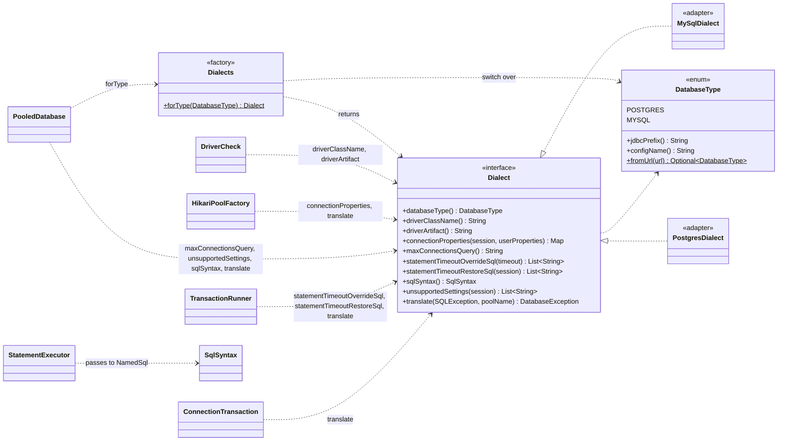
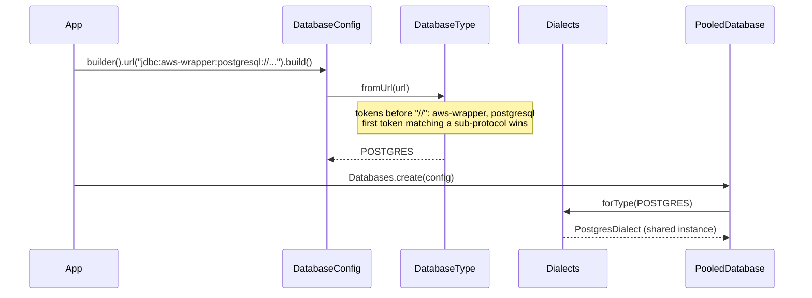

# ADR-0003: Multi-database support

- Status: Accepted
- Date: 2026-11-08

How different databases plug in through dialect adapters, and how their errors look the same.

1. [Dialect adapters and a factory for multiple databases](#1-dialect-adapters-and-a-factory-for-multiple-databases)
2. [Vendor-neutral error model](#2-vendor-neutral-error-model)
3. [MySQL dialect](#3-mysql-dialect)

## 1. Dialect adapters and a factory for multiple databases

### Context

plugkit-db must support several relational databases over time, starting with PostgreSQL. Each
database speaks its own dialect, and the differences plugkit-db cares about are:

| Concern | PostgreSQL | MySQL | SQL Server |
|---|---|---|---|
| JDBC URL sub-protocol | `postgresql` | `mysql` | `sqlserver` |
| Driver class | `org.postgresql.Driver` | `com.mysql.cj.jdbc.Driver` | `com.microsoft.sqlserver.jdbc.SQLServerDriver` |
| Unique violation | SQLState `23505` | error `1062` | error `2627`, `2601` |
| Deadlock | `40P01` | `1213` | `1205` |
| Server statement timeout | `statement_timeout` (every statement) | `max_execution_time` (SELECT only) | none; client timeout only |
| Lock wait timeout | `lock_timeout` (ms) | `innodb_lock_wait_timeout` (whole seconds) | `SET LOCK_TIMEOUT` (ms) |
| Idle-in-transaction timeout | `idle_in_transaction_session_timeout` | no equivalent | no equivalent |
| Where session settings go | driver property `options` at login | session variables | connection properties / `SET` |

The SQL text itself is the application's responsibility: plugkit-db is not an ORM and doesn't translate
queries. Everything else above must be handled once per database, behind one API, so application code
and the engine never change when a database is added.

### Decision

Use the **adapter pattern** with a **factory**:

- **`Dialect` is the port.** An internal interface listing every database-specific question the engine
  asks. The engine, the pool factory and the transaction runner depend only on this interface.
- **One adapter per database** implements it, in its own package `internal.dialect.<name>`. All
  vendor-specific code lives there, and `ArchitectureTest` enforces that only that package may use the
  vendor's driver classes.
- **`Dialects` is the factory.** `Dialects.forType(DatabaseType)` returns the adapter with an
  exhaustive `switch`. Adding a `DatabaseType` constant without registering a dialect doesn't compile.
- **`DatabaseType` names the supported databases.** It is public, because users may set it
  (`database-type: postgres`), and it is inferred from the URL when not set.
- **Dialects are bundled and stateless.** There is no `ServiceLoader` discovery; one shared instance
  per database serves every pool.
- **Dialects need no driver classes for their core job.** Error codes and session settings are strings.
  A dialect may use its driver for extras (PostgreSQL reads constraint names from `PSQLException`), with
  the driver as an optional dependency ([ADR-0001 part 2](0001-architecture-and-structure.md#2-one-artifact-with-optional-integrations)).

### Structure



#### What each `Dialect` method answers

| Method | Question | Called by | When |
|---|---|---|---|
| `databaseType()` | Which `DatabaseType` is this? | `DriverCheck` (messages) | Startup |
| `driverClassName()` / `driverArtifact()` | Which driver must be present, and which dependency provides it? | `DriverCheck` | Startup |
| `connectionProperties(session, user)` | Which driver properties apply the session timeouts, derived timeouts and safe defaults, merged with the user's? Which user keys are forbidden? | `HikariPoolFactory` | Startup |
| `maxConnectionsQuery()` | How is the server's connection limit read? | `PooledDatabase` | Startup check |
| `statementTimeoutOverrideSql(timeout)` | How is a different statement timeout set for one transaction? | `TransactionRunner` | Transaction begin, when the statement timeout differs from the session's |
| `statementTimeoutRestoreSql(session)` | How is that override undone? Empty when the override already ends with the transaction | `TransactionRunner` | Transaction end, after commit or rollback |
| `sqlSyntax()` | Which characters quote text, and which comment styles exist, so `:name` inside them isn't a parameter? | `StatementExecutor` → `NamedSql` | Every statement |
| `unsupportedSettings(session)` | Which configured settings can this database not enforce? | `PooledDatabase` (logged as warnings) | Startup |
| `translate(e, pool)` | Which `DatabaseException` does this vendor error mean? | Every statement path, pool start, health | On error |

#### Selecting a dialect



- Wrapper prefixes are skipped: `jdbc:aws-wrapper:postgresql:` and `jdbc:otel:postgresql:` both resolve
  to `postgres`.
- If `databaseType` is set it must match the URL: `databaseType is 'postgres' but url does not start with jdbc:postgresql:`.
- An unsupported URL fails: `url is not for a supported database; supported: postgres (jdbc:postgresql:), mysql (jdbc:mysql:)`.
- A wrapped `DataSource` is detected from its connection metadata URL the same way.

#### The PostgreSQL adapter

Connection properties produced by `PostgresDialect.connectionProperties`:

| Property | Value | Source |
|---|---|---|
| `connectTimeout` | `5` (seconds) | managed; a user value is rejected |
| `socketTimeout` | `session.statementTimeout` + 5s, rounded up to seconds | managed; a user value is rejected |
| `logServerErrorDetail` | `false` | default; the user may override |
| `options` | `-c statement_timeout=… -c lock_timeout=… -c idle_in_transaction_session_timeout=…` | managed; a user `options` value is appended after it |

- Session settings travel in `options`, so they apply at login with no extra round trip.
- `logServerErrorDetail=false` keeps the server's `DETAIL` text, which contains row values such as
  `Key (email)=(alice@example.com)`, out of driver exception messages and logs.
- `translate` maps SQLState codes to exception types ([part 2](#2-vendor-neutral-error-model)). Messages use
  the server's primary error text, never `DETAIL`. For pgjdbc's `BatchUpdateException`, whose message
  contains the SQL with bound values, it reads the underlying server error instead.
- The statement-timeout override is `set local statement_timeout = <ms>`, which ends with the
  transaction, so there are no restore statements.
- `sqlSyntax`: `'…'` and `"…"` quote text, `--` and `/* */` are comments, and `$$ … $$` / `$tag$ … $tag$`
  quote text.
- Nothing is unsupported: every session setting is enforced by the server.

#### Adding a database

1. Add a constant to `DatabaseType` with the URL sub-protocol, for example `MYSQL("mysql")`.
2. Create `internal/dialect/<name>/<Name>Dialect implements Dialect`. The build fails until step 3.
3. Add the `case` to `Dialects.forType`.
4. Add the driver as an optional dependency only if the dialect needs driver classes.
5. Add `<Name>DialectTest extends DialectContractTest` (the shared rules every dialect must pass) plus the
   database's own error mapping and connection properties, and Testcontainers integration tests.
6. Add an `ArchitectureTest` rule keeping the driver's classes inside the dialect's package, and a part
   to this ADR describing the dialect.

MySQL was added this way ([part 3](#3-mysql-dialect)).

Nothing outside `internal.dialect` changes: the engine, the public API, the Spring integration and
application code stay the same. Users switch databases by changing the driver dependency and the URL.

### Consequences

- One API for every database; vendor differences are contained in one class per database.
- The exhaustive `switch` turns "forgot to register the dialect" into a compile error.
- Settings a database can't enforce are reported as startup warnings through `unsupportedSettings`,
  instead of being silently ignored.
- `DialectContractTest` holds the rules every dialect must pass; each dialect's test extends it.
- Statement timeouts and lock timeouts have different units and semantics per database; each adapter
  documents how it maps them.

## 2. Vendor-neutral error model

### Context

JDBC reports every failure as `SQLException` with a vendor-specific SQLState or error code. Callers
end up matching strings like `23505`, and code written for one database breaks on another. Retry logic
needs to know which failures are worth retrying. Driver messages can also contain row and parameter
values, which must not reach logs.

### Decision

- Every database failure is thrown as an unchecked `DatabaseException` subtype that describes what went
  wrong, independent of the vendor. The original `SQLException` is kept as the cause.
- Each dialect translates its vendor codes ([part 1](#1-dialect-adapters-and-a-factory-for-multiple-databases)).
- `isRetryable()` is `true` only for `TransientFailure`; the transaction engine and `@RetryOnTransient`
  rely on it.
- Base and category classes have package-private constructors and leaf classes are `final`, so the
  hierarchy can't be extended outside the library.
- Messages are the server's primary error text plus `[pool=…, SQLState=…]`. They never include the
  server's `DETAIL` or bound values.
- Configuration problems are a separate `InvalidConfigException` from plugkit-core, thrown at startup.
- `DatabaseException` and `InvalidConfigException` extend plugkit-core's `PlugkitException`
  ([ADR-0001 part 5](0001-architecture-and-structure.md#5-shared-plugkit-core-module)).

### Structure


#### PostgreSQL mapping

| Exception | PostgreSQL | Retryable |
|---|---|---|
| `UniqueViolation` | `23505` | no |
| `ForeignKeyViolation` | `23503` | no |
| `NotNullViolation` | `23502` | no |
| `CheckViolation` | `23514` | no |
| `SerializationFailure` | `40001` | yes |
| `Deadlock` | `40P01` | yes |
| `ConnectionLost` | `08xxx`, `57P01`–`57P03` (server shutting down or not accepting connections) | yes |
| `StatementTimeout` | `57014` | no |
| `LockTimeout` | `55P03` | no |
| `TransactionTimeout` | engine deadline, `25P03` (idle-in-transaction timeout) | no |
| `AcquireTimeout` | Hikari's `SQLTransientConnectionException` when the pool is exhausted | no |
| `CommitOutcomeUnknown` | connection lost while a commit is in flight | no |
| `QueryFailure` | everything else, including a missing SQLState | no |

#### Where translation happens

| Path | Translator |
|---|---|
| Pool start (first connection) | `HikariPoolFactory` → `dialect.translate` |
| Auto-commit statements | `PooledDatabase.runOnConnection` |
| Statements in a transaction | `ConnectionTransaction`; a cancellation after the deadline becomes `TransactionTimeout` |
| Commit | `TransactionRunner.commit`; `ConnectionLost` becomes `CommitOutcomeUnknown` |
| Column reads in a `RowMapper` | `ResultSetRow` wraps `SQLException` in `UncheckedSqlException`; the engine unwraps and translates it ([ADR-0004 part 1](0004-running-sql.md#1-plain-sql-with-named-parameters-and-row-mappers)) |
| Pool exhaustion | `TranslatingConnectionProvider` → `AcquireTimeout` with active, idle and waiting counts |
| Health check | `PooledDatabase.health()` puts the translated message in `Health.problem` |

Example messages:

```
duplicate key value violates unique constraint "users_email_key" [pool=orders, SQLState=23505]
No connection available within 300 ms [pool=orders, active=1, idle=0, waiting=0]. Increase pool.maxSize, or look for slow queries or connections that are not closed.
Transaction exceeded its timeout of 1500ms [pool=orders]
Connection lost during commit; the transaction may or may not have been applied [pool=orders]
```

### Consequences

- Application code catches `UniqueViolation`, not `"23505"`, and keeps working on another database.
- Retry decisions come from the type, not from string matching.
- `constraintName()` is filled when the driver reports it (PostgreSQL via `ServerErrorMessage`).
- Adding a database means adding its mapping table; the hierarchy stays the same.

## 3. MySQL dialect

### Context

MySQL is the second supported database. It differs from PostgreSQL in ways the engine must not see:
error codes instead of SQLStates, session variables instead of login options, no transaction-scoped
settings, backtick identifiers, backslash escapes and `#` comments, and some timeouts it can't enforce
at all. Its duplicate-key error message also contains the duplicate value.

### Decision

- **`MySqlDialect` uses only standard JDBC types.** It reads `SQLException.getErrorCode()` and the
  message text, so it needs no MySQL driver classes and adds no compile-time dependency. The driver,
  `com.mysql:mysql-connector-j`, is added by the application.
- **Session timeouts travel in Connector/J's `sessionVariables`**: `max_execution_time` (statement
  timeout) and `innodb_lock_wait_timeout` (lock timeout, whole seconds).
- **The statement-timeout override is undone after the transaction.** MySQL has no `set local`, so the
  override is `set session max_execution_time` and the restore statement sets it back to the session
  default. Without the restore, the changed limit would stay on the pooled connection for the next user.
- **Duplicate-key messages are rebuilt.** The server's text, `Duplicate entry 'alice@example.com' for key
  'users.email'`, contains the value; the translated message keeps only the key name.
- **What MySQL can't enforce is reported at startup**, not silently ignored.

### Structure

Connection properties produced by `MySqlDialect.connectionProperties`:

| Property | Value | Source |
|---|---|---|
| `connectTimeout` | `5000` (milliseconds) | managed; a user value is rejected |
| `socketTimeout` | `session.statementTimeout` + 5s, in milliseconds | managed; a user value is rejected |
| `sessionVariables` | `max_execution_time=<ms>,innodb_lock_wait_timeout=<s>` | managed; a user `sessionVariables` value is appended after it |

| Concern | MySQL behaviour |
|---|---|
| Statement-timeout override | `set session max_execution_time = <ms>`, restored to the session value after commit or rollback (also after a joined Spring transaction's callback) |
| `sqlSyntax` | `'…'`, `"…"` and `` `…` `` quote text or identifiers; `\'` is an escaped quote; `#` and `-- ` (with a space) start comments; no dollar quoting |
| `maxConnectionsQuery` | `select @@max_connections` |
| Messages | server text plus `[pool=…, SQLState=…, errorCode=…]`; duplicate keys rebuilt without the value |

Startup warnings from `unsupportedSettings`:

| Setting | Why it's reported |
|---|---|
| `session.statementTimeout` | `max_execution_time` applies to SELECT statements only; other statements are stopped by the driver's socket timeout (statement timeout + 5s) and fail with `ConnectionLost` |
| `session.idleInTransactionTimeout` | MySQL has no equivalent setting |
| `session.lockTimeout` (only when not whole seconds) | `innodb_lock_wait_timeout` is in whole seconds, so the value is rounded up |

Error mapping:

| Exception | MySQL error code | Retryable |
|---|---|---|
| `UniqueViolation` | `1062`, `1586`; key name read from the message | no |
| `ForeignKeyViolation` | `1216`, `1217`, `1451`, `1452`; constraint name read from the message | no |
| `NotNullViolation` | `1048`, `1364` | no |
| `CheckViolation` | `3819`; constraint name read from the message | no |
| `Deadlock` | `1213` | yes |
| `LockTimeout` | `1205` | no |
| `StatementTimeout` | `3024` (`max_execution_time`), `1317` / SQLState `70100` / `SQLTimeoutException` (client cancel) | no |
| `ConnectionLost` | `1040`, `1053`, any SQLState `08xxx` | yes |
| `QueryFailure` | everything else | no |

For a batch failure, the error is read from the `BatchUpdateException`'s next exception or cause.

### Consequences

- Application code, configuration keys and exception types are the same on MySQL and PostgreSQL; only
  the URL and the driver dependency change.
- Long-running non-SELECT statements on MySQL end with `ConnectionLost` from the socket timeout rather
  than `StatementTimeout`; the startup warning says so.
- Constraint and key names depend on MySQL's message wording; if the wording changes, the name is
  missing but the exception type is still correct.
- `MySqlDatabaseIT` verifies session variables, CRUD, unique-key translation without the value, quoting,
  lock wait timeout, deadlock retry, override restore and health against MySQL 8.4.

