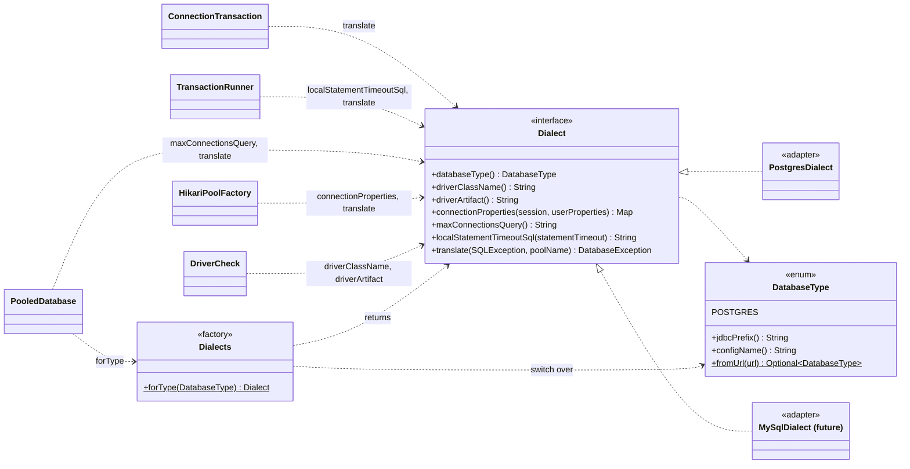
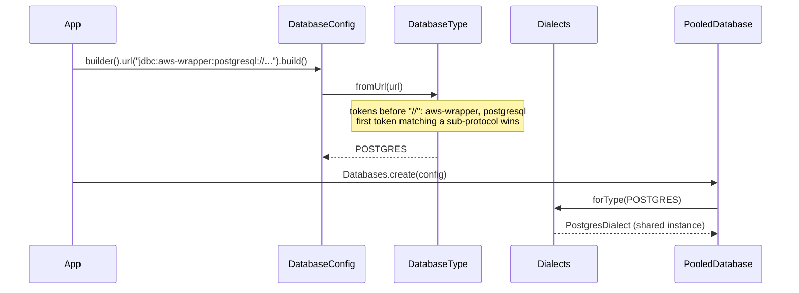
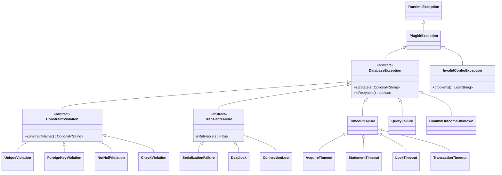

# ADR-0003: Multi-database support

- Status: Accepted
- Date: 2026-11-08

How different databases plug in through dialect adapters, and how their errors look the same.

1. [Dialect adapters and a factory for multiple databases](#1-dialect-adapters-and-a-factory-for-multiple-databases)
2. [Vendor-neutral error model](#2-vendor-neutral-error-model)

## 1. Dialect adapters and a factory for multiple databases

### Context

plugkit-db must support several relational databases over time, starting with PostgreSQL. Each
database speaks its own dialect, and the differences plugkit-db cares about are:

| Concern | PostgreSQL | MySQL | SQL Server |
|---|---|---|---|
| JDBC URL sub-protocol | `postgresql` | `mysql` | `sqlserver` |
| Driver class | `org.postgresql.Driver` | `com.mysql.cj.jdbc.Driver` | `com.microsoft.sqlserver.jdbc.SQLServerDriver` |
| Unique violation | SQLState `23505` | error `1062` | error `2627`, `2601` |
| Deadlock | `40P01` | `1213` | `1205` |
| Server statement timeout | `statement_timeout` (every statement) | `max_execution_time` (SELECT only) | none; client timeout only |
| Lock wait timeout | `lock_timeout` (ms) | `innodb_lock_wait_timeout` (whole seconds) | `SET LOCK_TIMEOUT` (ms) |
| Idle-in-transaction timeout | `idle_in_transaction_session_timeout` | no equivalent | no equivalent |
| Where session settings go | driver property `options` at login | session variables | connection properties / `SET` |

The SQL text itself is the application's responsibility: plugkit-db is not an ORM and doesn't translate
queries. Everything else above must be handled once per database, behind one API, so application code
and the engine never change when a database is added.

### Decision

Use the **adapter pattern** with a **factory**:

- **`Dialect` is the port.** An internal interface listing every database-specific question the engine
  asks. The engine, the pool factory and the transaction runner depend only on this interface.
- **One adapter per database** implements it, in its own package `internal.dialect.<name>`. All
  vendor-specific code lives there, and `ArchitectureTest` enforces that only that package may use the
  vendor's driver classes.
- **`Dialects` is the factory.** `Dialects.forType(DatabaseType)` returns the adapter with an
  exhaustive `switch`. Adding a `DatabaseType` constant without registering a dialect doesn't compile.
- **`DatabaseType` names the supported databases.** It is public, because users may set it
  (`database-type: postgres`), and it is inferred from the URL when not set.
- **Dialects are bundled and stateless.** There is no `ServiceLoader` discovery; one shared instance
  per database serves every pool.
- **Dialects need no driver classes for their core job.** Error codes and session settings are strings.
  A dialect may use its driver for extras (PostgreSQL reads constraint names from `PSQLException`), with
  the driver as an optional dependency ([ADR-0001 part 2](0001-architecture-and-structure.md#2-one-artifact-with-optional-integrations)).

### Structure



#### What each `Dialect` method answers

| Method | Question | Called by | When |
|---|---|---|---|
| `databaseType()` | Which `DatabaseType` is this? | `DriverCheck` (messages) | Startup |
| `driverClassName()` / `driverArtifact()` | Which driver must be present, and which dependency provides it? | `DriverCheck` | Startup |
| `connectionProperties(session, user)` | Which driver properties apply the session timeouts, derived timeouts and safe defaults, merged with the user's? Which user keys are forbidden? | `HikariPoolFactory` | Startup |
| `maxConnectionsQuery()` | How is the server's connection limit read? | `PooledDatabase` | Startup check |
| `localStatementTimeoutSql(timeout)` | How is a statement timeout set for the current transaction only? | `TransactionRunner` | Transaction begin, when the statement timeout differs from the session's |
| `translate(e, pool)` | Which `DatabaseException` does this vendor error mean? | Every statement path, pool start, health | On error |

#### Selecting a dialect



- Wrapper prefixes are skipped: `jdbc:aws-wrapper:postgresql:` and `jdbc:otel:postgresql:` both resolve
  to `postgres`.
- If `databaseType` is set it must match the URL: `databaseType is 'postgres' but url does not start with jdbc:postgresql:`.
- An unsupported URL fails: `url is not for a supported database; supported: postgres (jdbc:postgresql:)`.
- A wrapped `DataSource` is detected from its connection metadata URL the same way.

#### The PostgreSQL adapter

Connection properties produced by `PostgresDialect.connectionProperties`:

| Property | Value | Source |
|---|---|---|
| `connectTimeout` | `5` (seconds) | managed; a user value is rejected |
| `socketTimeout` | `session.statementTimeout` + 5s, rounded up to seconds | managed; a user value is rejected |
| `logServerErrorDetail` | `false` | default; the user may override |
| `options` | `-c statement_timeout=… -c lock_timeout=… -c idle_in_transaction_session_timeout=…` | managed; a user `options` value is appended after it |

- Session settings travel in `options`, so they apply at login with no extra round trip.
- `logServerErrorDetail=false` keeps the server's `DETAIL` text, which contains row values such as
  `Key (email)=(alice@example.com)`, out of driver exception messages and logs.
- `translate` maps SQLState codes to exception types ([part 2](#2-vendor-neutral-error-model)). Messages use
  the server's primary error text, never `DETAIL`. For pgjdbc's `BatchUpdateException`, whose message
  contains the SQL with bound values, it reads the underlying server error instead.
- `localStatementTimeoutSql` returns `set local statement_timeout = <ms>`.

#### Adding a database

1. Add a constant to `DatabaseType` with the URL sub-protocol, for example `MYSQL("mysql")`.
2. Create `internal/dialect/mysql/MySqlDialect implements Dialect`. The build fails until step 3.
3. Add `case MYSQL -> MYSQL_DIALECT;` to `Dialects.forType`.
4. Add the driver as an optional dependency only if the dialect needs driver classes.
5. Add `MySqlDialectTest` (error mapping, connection properties) and Testcontainers integration tests.
6. Introduce the shared `DialectContractTest` and a way for a dialect to report session settings it
   can't enforce; both are deferred until this second dialect exists (see Consequences).

An illustrative skeleton (not part of the code base):

```java
public final class MySqlDialect implements Dialect {

    public DatabaseType databaseType() { return DatabaseType.MYSQL; }

    public String driverClassName() { return "com.mysql.cj.jdbc.Driver"; }

    public String driverArtifact() { return "com.mysql:mysql-connector-j"; }

    public Map<String, String> connectionProperties(SessionConfig session, Map<String, String> user) {
        return Map.of(
                "connectTimeout", "5000",
                "socketTimeout", String.valueOf(session.statementTimeout().plusSeconds(5).toMillis()),
                "sessionVariables", "max_execution_time=" + session.statementTimeout().toMillis()
                        + ",innodb_lock_wait_timeout=" + Math.max(1, session.lockTimeout().toSeconds()));
    }

    public String maxConnectionsQuery() { return "select @@max_connections"; }

    public String localStatementTimeoutSql(Duration timeout) {
        return "set session max_execution_time = " + timeout.toMillis();
    }

    public DatabaseException translate(SQLException e, String poolName) {
        return switch (e.getErrorCode()) {
            case 1062 -> new UniqueViolation(message(e, poolName), null, e.getSQLState(), e);
            case 1213 -> new Deadlock(message(e, poolName), e.getSQLState(), e);
            default -> new QueryFailure(message(e, poolName), e.getSQLState(), e);
        };
    }
}
```

Nothing outside `internal.dialect` changes: the engine, the public API, the Spring integration and
application code stay the same. Users switch databases by changing the driver dependency and the URL.

### Consequences

- One API for every database; vendor differences are contained in one class per database.
- The exhaustive `switch` turns "forgot to register the dialect" into a compile error.
- Settings a database can't enforce (for example MySQL has no idle-in-transaction timeout) need a way
  to be reported as startup warnings; this is added with the second dialect, together with a
  `DialectContractTest` every dialect must pass. Until then, with only PostgreSQL, there is nothing to
  compare against.
- Statement timeouts and lock timeouts have different units and semantics per database; each adapter
  documents how it maps them.

## 2. Vendor-neutral error model

### Context

JDBC reports every failure as `SQLException` with a vendor-specific SQLState or error code. Callers
end up matching strings like `23505`, and code written for one database breaks on another. Retry logic
needs to know which failures are worth retrying. Driver messages can also contain row and parameter
values, which must not reach logs.

### Decision

- Every database failure is thrown as an unchecked `DatabaseException` subtype that describes what went
  wrong, independent of the vendor. The original `SQLException` is kept as the cause.
- Each dialect translates its vendor codes ([part 1](#1-dialect-adapters-and-a-factory-for-multiple-databases)).
- `isRetryable()` is `true` only for `TransientFailure`; the transaction engine and `@RetryOnTransient`
  rely on it.
- Base and category classes have package-private constructors and leaf classes are `final`, so the
  hierarchy can't be extended outside the library.
- Messages are the server's primary error text plus `[pool=…, SQLState=…]`. They never include the
  server's `DETAIL` or bound values.
- Configuration problems are a separate `InvalidConfigException` from plugkit-core, thrown at startup.
- `DatabaseException` and `InvalidConfigException` extend plugkit-core's `PlugkitException`
  ([ADR-0001 part 5](0001-architecture-and-structure.md#5-shared-plugkit-core-module)).

### Structure



#### PostgreSQL mapping

| Exception | PostgreSQL | Retryable |
|---|---|---|
| `UniqueViolation` | `23505` | no |
| `ForeignKeyViolation` | `23503` | no |
| `NotNullViolation` | `23502` | no |
| `CheckViolation` | `23514` | no |
| `SerializationFailure` | `40001` | yes |
| `Deadlock` | `40P01` | yes |
| `ConnectionLost` | `08xxx`, `57P01`–`57P03` (server shutting down or not accepting connections) | yes |
| `StatementTimeout` | `57014` | no |
| `LockTimeout` | `55P03` | no |
| `TransactionTimeout` | engine deadline, `25P03` (idle-in-transaction timeout) | no |
| `AcquireTimeout` | Hikari's `SQLTransientConnectionException` when the pool is exhausted | no |
| `CommitOutcomeUnknown` | connection lost while a commit is in flight | no |
| `QueryFailure` | everything else, including a missing SQLState | no |

#### Where translation happens

| Path | Translator |
|---|---|
| Pool start (first connection) | `HikariPoolFactory` → `dialect.translate` |
| Auto-commit statements | `PooledDatabase.runOnConnection` |
| Statements in a transaction | `ConnectionTransaction`; a cancellation after the deadline becomes `TransactionTimeout` |
| Commit | `TransactionRunner.commit`; `ConnectionLost` becomes `CommitOutcomeUnknown` |
| Column reads in a `RowMapper` | `ResultSetRow` wraps `SQLException` in `UncheckedSqlException`; the engine unwraps and translates it ([ADR-0004 part 1](0004-running-sql.md#1-plain-sql-with-named-parameters-and-row-mappers)) |
| Pool exhaustion | `TranslatingConnectionProvider` → `AcquireTimeout` with active, idle and waiting counts |
| Health check | `PooledDatabase.health()` puts the translated message in `Health.problem` |

Example messages:

```
duplicate key value violates unique constraint "users_email_key" [pool=orders, SQLState=23505]
No connection available within 300 ms [pool=orders, active=1, idle=0, waiting=0]. Increase pool.maxSize, or look for slow queries or connections that are not closed.
Transaction exceeded its timeout of 1500ms [pool=orders]
Connection lost during commit; the transaction may or may not have been applied [pool=orders]
```

### Consequences

- Application code catches `UniqueViolation`, not `"23505"`, and keeps working on another database.
- Retry decisions come from the type, not from string matching.
- `constraintName()` is filled when the driver reports it (PostgreSQL via `ServerErrorMessage`).
- Adding a database means adding its mapping table; the hierarchy stays the same.
