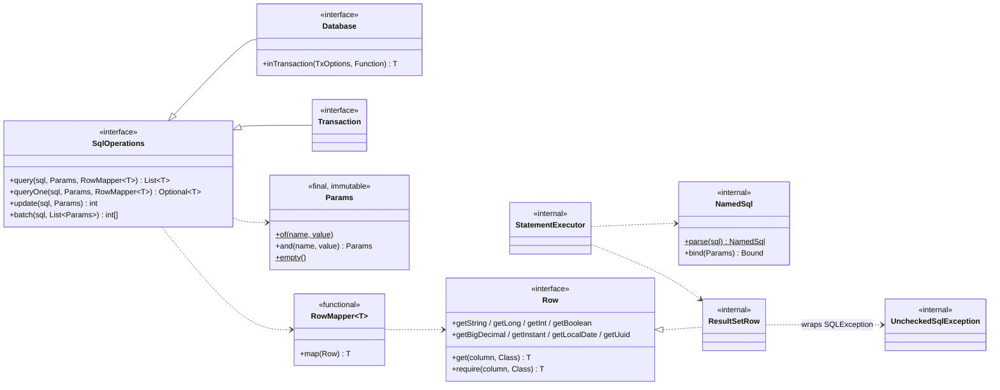
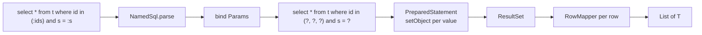
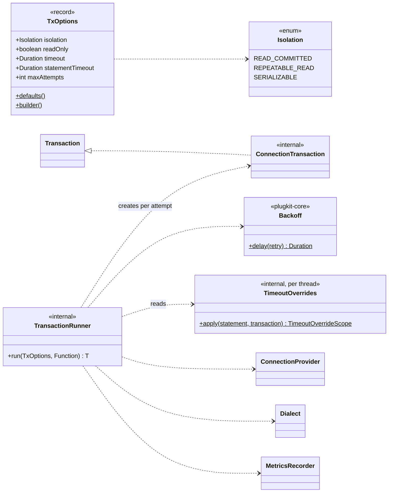
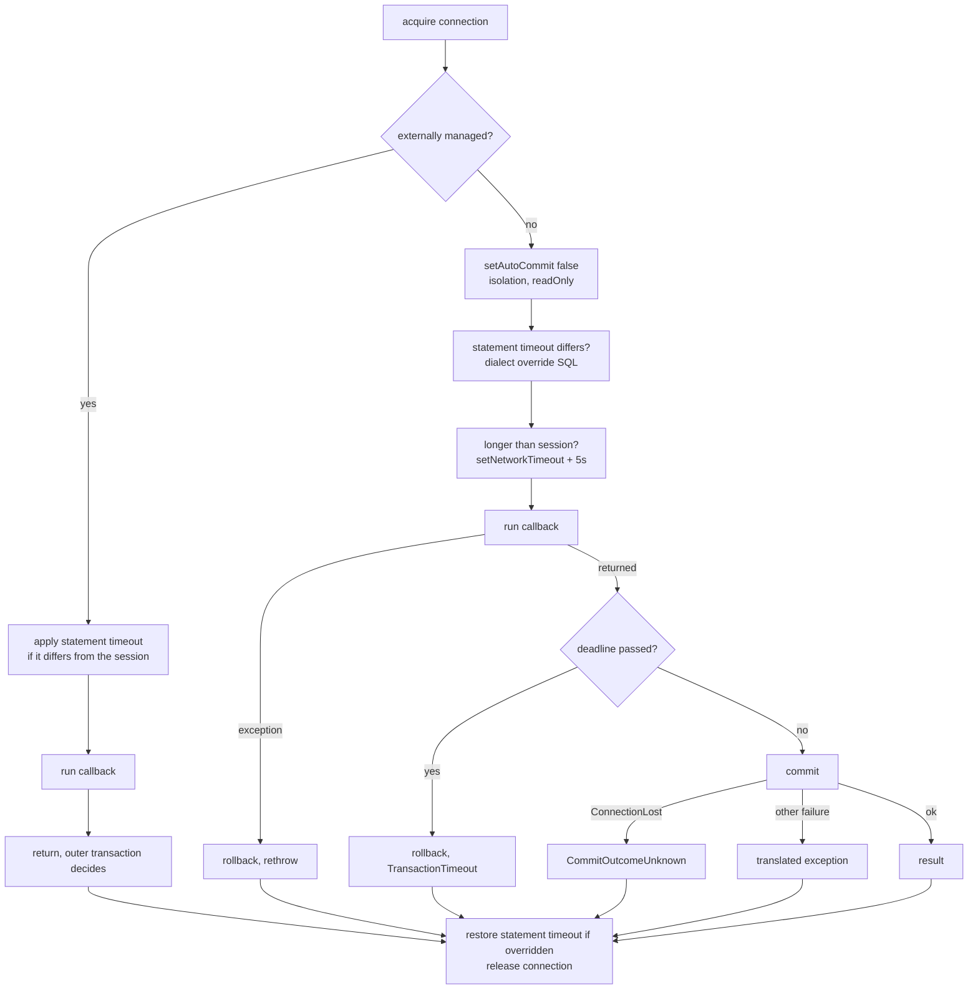
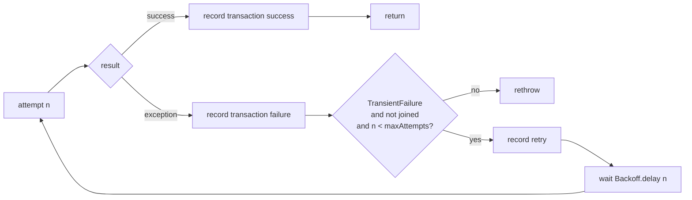
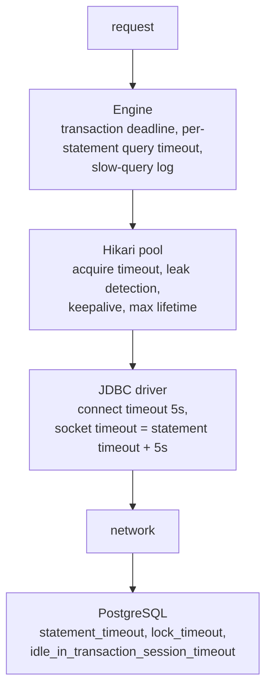

# ADR-0004: Running SQL

- Status: Accepted
- Date: 2026-11-08

How statements and transactions run, and how every layer is protected by a timeout.

1. [Plain SQL with named parameters and row mappers](#1-plain-sql-with-named-parameters-and-row-mappers)
2. [Transactions with deadlines, opt-in retry and safe commits](#2-transactions-with-deadlines-opt-in-retry-and-safe-commits)
3. [Timeouts at every layer](#3-timeouts-at-every-layer)

## 1. Plain SQL with named parameters and row mappers

### Context

Applications need to run SQL safely and map results without an ORM. Raw JDBC is verbose (statements,
result sets, checked exceptions, positional `?`), and string-built SQL invites injection. The same
statements must work outside and inside a transaction.

### Decision

- **One statement interface, two implementations.** `SqlOperations` declares `query`, `queryOne`,
  `update` and `batch`. `Database` runs each call on its own connection in auto-commit; `Transaction`
  runs it on the transaction's connection.
- **Named parameters only.** SQL uses `:name` placeholders bound from `Params`. The API never builds SQL
  from string fragments.
- **Rows are mapped by a function.** `RowMapper<T>` maps one `Row`; `Row` offers typed getters that
  return `null` for SQL `NULL` and `require` for columns that must have a value.
- **Values never leak.** `Params.toString()` lists names only, and the slow-query log prints SQL text
  without parameters.

### Structure





#### Parameters

- `Params.of("id", 42).and("status", "OPEN")`. Values may be `null`; names must be identifiers and can't
  repeat.
- The parser skips quoted text, quoted identifiers and comments according to the database's `SqlSyntax`
  (PostgreSQL: `'…'`, `"…"`, `$$ … $$`; MySQL: `'…'` with `\'` escapes, `"…"`, `` `…` ``, `#` comments),
  plus `/* */` comments and `::` casts ([ADR-0003](0003-multi-database-support.md#1-dialect-adapters-and-a-factory-for-multiple-databases)).
- A `Collection` value expands for `IN` lists; an empty collection is rejected. Arrays bind as one
  value (for `= any(:ids)`).
- `Instant` binds as a UTC `OffsetDateTime`; enums bind as `name()`; everything else goes to
  `setObject`.
- A placeholder with no value throws `IllegalArgumentException` listing the given names. Extra values
  are ignored, so one `Params` can serve several statements.

#### Rows

- A `Row` is only valid inside the mapper call.
- `getLong`, `getInt` and `getBoolean` use the JDBC primitive getters plus `wasNull`, so they accept any
  compatible column type. `get(column, Class)` uses `getObject(column, Class)`; `Instant` is read as
  `OffsetDateTime` and converted.
- `require(column, Class)` returns a value or throws `QueryFailure` naming the column.
- `RowMapper.map` can't throw `SQLException`, so `ResultSetRow` wraps it in the internal
  `UncheckedSqlException`; the engine always catches and translates it, and it never reaches
  applications.

#### Statements

| Method | Behaviour |
|---|---|
| `query` | All rows, mapped |
| `queryOne` | Zero or one row; more than one throws `QueryFailure`. Fetches at most two rows. Works with `insert … returning` |
| `update` | Row count; also for DDL |
| `batch` | One prepared statement; per-row counts. On `Database` it runs in its own transaction, so it's atomic; inside a `Transaction` it joins that transaction. Every row must expand to the same SQL. An empty list does nothing |

| Class | Responsibility |
|---|---|
| `StatementExecutor` | Prepares, binds and runs statements on a given connection with an optional query timeout; logs statements slower than `slowQueryThreshold` without values |
| `NamedSql` | Parses placeholders and binds values |
| `ResultSetRow` | `Row` view over the current `ResultSet` row |
| `UncheckedSqlException` | Carries `SQLException` out of mappers |

```java
record User(long id, String email) {
    static User from(Row row) {
        return new User(row.require("id", Long.class), row.require("email", String.class));
    }
}

List<User> active = db.query("select * from users where status = :status",
        Params.of("status", Status.ACTIVE), User::from);
```

### Consequences

- Queries are plain SQL that DBAs can read; injection through the API isn't possible.
- The same code runs in or out of a transaction because both share `SqlOperations`.
- Results are loaded into a `List`; streaming very large results is not supported yet.
- Each dialect supplies its quoting rules, so a `:name` inside a MySQL backtick identifier or `#`
  comment isn't mistaken for a parameter.

## 2. Transactions with deadlines, opt-in retry and safe commits

### Context

Several statements often have to succeed or fail together. Production transactions also face
deadlocks and serialization failures (worth retrying), transactions that run far too long and hold
locks, and connections that drop during commit, when it is unknown whether the commit was applied.
Inside Spring applications, a `@Transactional` method may already have started a transaction.

### Decision

- `Database.inTransaction(TxOptions, Function<Transaction, T>)` runs a callback in one transaction and
  returns its result. Any exception rolls back and is rethrown unchanged.
- **Deadline per transaction.** Each statement gets the time left, capped at the statement timeout.
- **Retry is opt-in** (`maxAttempts > 1`), because the callback may have side effects. Only
  `TransientFailure` is retried, and the whole callback reruns in a new transaction.
- **A lost commit is never retried.** It becomes `CommitOutcomeUnknown`.
- **Externally managed transactions are joined**, not nested or replaced.

### Structure



#### Options

| Option | Default | Notes |
|---|---|---|
| `isolation` | database default (PostgreSQL: READ COMMITTED) | |
| `readOnly` | false | Writes fail with `QueryFailure` (PostgreSQL SQLState `25006`) |
| `timeout` | `@Timeouts` override, else `tx.defaultTimeout` (60s) | Deadline for the whole transaction |
| `statementTimeout` | `@Timeouts` override, else `session.statementTimeout` (30s) | |
| `maxAttempts` | 1 (no retry) | 1 to 10 |

#### Lifecycle of one attempt



Hikari restores auto-commit, isolation, read-only and the network timeout when a connection returns to
the pool. A statement-timeout override is undone with the dialect's restore SQL after commit or
rollback; PostgreSQL's `set local` ends with the transaction anyway, MySQL's `set session` is set back.

#### Retry loop



- `Backoff.delay(n)` is random between 0 and `min(2s, 50ms × 2^(n-1))` (full jitter), which spreads
  competing transactions apart.
- Each attempt gets a fresh deadline.
- A serialization failure raised at commit is retryable; a connection lost at commit is not.
- An interrupt during the wait rethrows the last failure with the interrupt flag restored.

#### Deadline and timeouts

| Mechanism | Effect |
|---|---|
| Deadline check before each statement | Fails with `TransactionTimeout` without reaching the database |
| JDBC query timeout per statement | `min(time left, statementTimeout)`, rounded up to whole seconds (JDBC's unit); a cancellation after the deadline becomes `TransactionTimeout` |
| Deadline check before commit | A callback that overran rolls back with `TransactionTimeout` |
| Dialect statement-timeout override | Server-side limit for this transaction when it differs from the session's; restored afterwards |
| `setNetworkTimeout(statementTimeout + 5s)` | When the transaction allows longer statements than the session, so the socket backstop doesn't cut them short |

#### Joined transactions

When `ConnectionProvider.isExternallyManaged` is `true` (a Spring `@Transactional` on the same
`DataSource`, see [ADR-0005 part 3](0005-integrations.md#3-spring-boot-4-integration)):

- no begin, commit, rollback or retry; the outer transaction owns them;
- isolation and read-only come from the outer transaction; `TxOptions` values for them are ignored;
- deadlines and statement timeouts still apply to plugkit-db's statements.

#### Other rules

- A `Transaction` used after its callback returns throws `IllegalStateException`.
- Calling `db.inTransaction` inside a callback (without Spring) opens a separate transaction on another
  connection.
- `Database.batch` runs on top of `inTransaction`.

```java
db.inTransaction(TxOptions.builder().isolation(Isolation.SERIALIZABLE).maxAttempts(3).build(), tx -> {
    tx.update("update accounts set balance = balance - :amt where id = :id", debit);
    tx.update("update accounts set balance = balance + :amt where id = :id", credit);
    return null;
});
```

### Consequences

- Deadlocks and serialization failures can be handled with one option instead of hand-written loops.
- A transaction can't hold locks past its deadline.
- Callers learn explicitly when a commit's outcome is unknown and must check before retrying.
- With retries, total time can reach `maxAttempts × timeout`; callers choose both.
- Deadline precision is about one second, because JDBC query timeouts are in whole seconds.

## 3. Timeouts at every layer

### Context

A database call can hang at several points: waiting for a pooled connection, connecting, executing,
waiting for a lock, waiting on a silent network, or sitting idle inside a transaction. A hang ties up a
thread and a connection, and under load it spreads. JDBC's defaults include no socket timeout, so a
network black hole blocks a thread forever.

### Decision

Every layer has a watchdog with a safe default, and the layers are ordered so the most precise one fires
first: the server cancels a slow statement before the client gives up on the socket.

### Structure



| Layer | Watchdog | Setting | Default | On expiry |
|---|---|---|---|---|
| Pool | Wait for a free connection | `pool.acquireTimeout` | 5s | `AcquireTimeout` with pool stats |
| Pool | Connection held too long | `pool.leakDetection` | 60s | Warning with the borrower's stack trace |
| Pool | Idle socket keepalive | `pool.keepalive` | 2m | Dead connection replaced |
| Pool | Connection age | `pool.maxLifetime` | 30m | Connection retired |
| Driver | Connect | derived | 5s | `ConnectionLost` |
| Driver | Silent network during a query | derived `socketTimeout` | statement timeout + 5s | `ConnectionLost` |
| Server | Statement runtime | `session.statementTimeout` | 30s | `StatementTimeout` |
| Server | Lock wait | `session.lockTimeout` | 10s | `LockTimeout` |
| Server | Idle inside an open transaction | `session.idleInTransactionTimeout` | 60s | session ended; `TransactionTimeout` |
| Engine | Whole transaction | `tx.defaultTimeout`, `TxOptions.timeout`, `@Timeouts` | 60s | `TransactionTimeout` |
| Engine | Slow statement | `slowQueryThreshold` | 1s | Warning with SQL text, no values |
| Lifecycle | Running work at shutdown | `pool.shutdownTimeout` | 10s | Pool closed anyway, with a warning ([ADR-0002 part 3](0002-connections-configuration-and-lifecycle.md#3-lifecycle-and-graceful-shutdown)) |

#### Ordering rules

- `socketTimeout` is always derived from `statementTimeout` and can't be set, so the client never hangs
  up on a statement the server is still allowed to run.
- When a transaction raises its statement timeout above the session's, the engine raises the
  connection's network timeout to match ([part 2](#2-transactions-with-deadlines-opt-in-retry-and-safe-commits)).
- Per-transaction and per-method overrides (`TxOptions`, `@Timeouts`) let the few long operations opt in
  instead of loosening the defaults for everyone.

### Consequences

- No call can block forever; every expiry produces a specific exception or log line.
- `NetworkFailureIT` proves the socket backstop: a black-holed network fails with `ConnectionLost` after
  about six seconds with a one-second statement timeout ([ADR-0001 part 4](0001-architecture-and-structure.md#4-testing-strategy)).
- Strict defaults stop legitimate long work until it opts in; this is intended.
- For a wrapped `DataSource`, plugkit-db can't set the driver and server timeouts; only the engine-level
  watchdogs apply.
