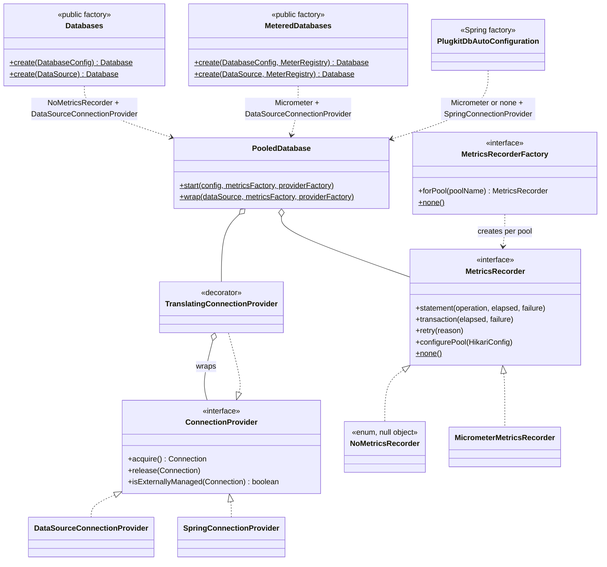
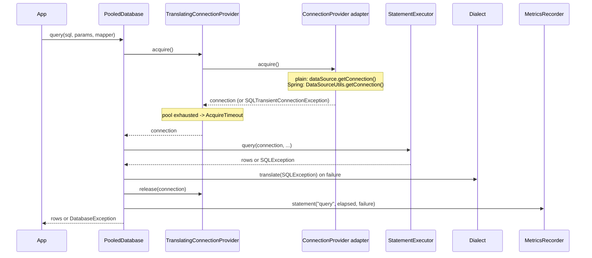
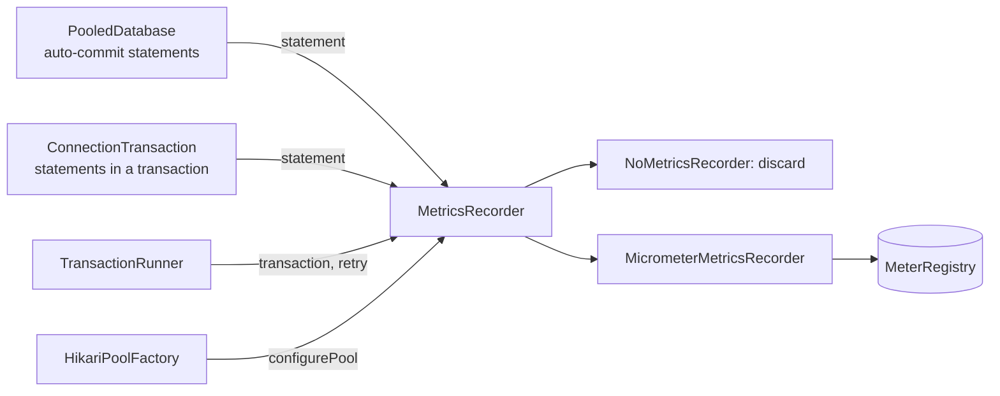
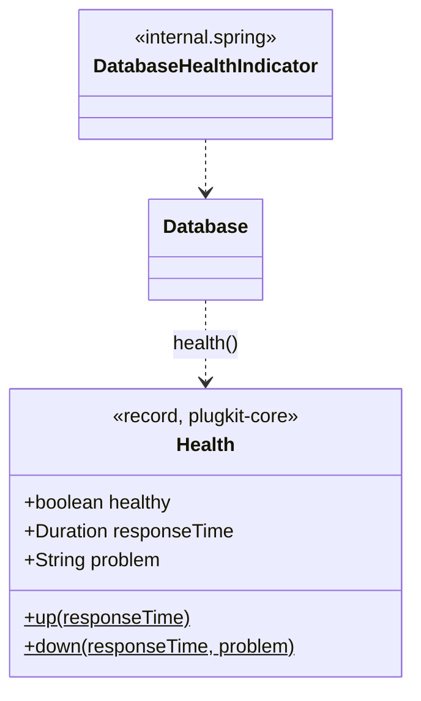
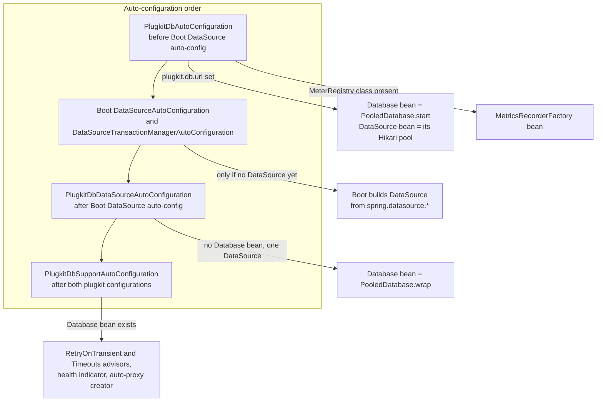
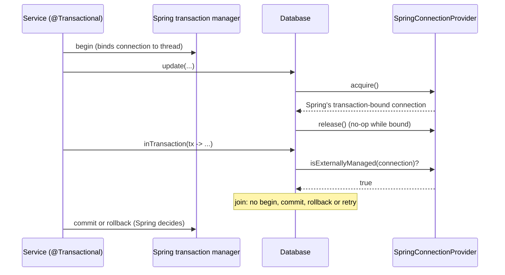

# ADR-0005: Integrations

- Status: Accepted
- Date: 2026-11-08

How plugkit-db fits into plain Java, Micrometer and Spring Boot through adapters and factories.

1. [Integration adapters and factories](#1-integration-adapters-and-factories)
2. [Logging, metrics and health](#2-logging-metrics-and-health)
3. [Spring Boot 4 integration](#3-spring-boot-4-integration)

## 1. Integration adapters and factories

### Context

The same engine has to run in different environments:

- plain Java, with nothing but a JDBC driver;
- applications that record metrics with Micrometer;
- Spring Boot applications, where statements must join Spring's `@Transactional` transactions;
- later, possibly other frameworks (Quarkus, Micronaut) or other metrics systems (OpenTelemetry).

The engine must not depend on any of them, and optional libraries must never be loaded when absent
([ADR-0001 part 2](0001-architecture-and-structure.md#2-one-artifact-with-optional-integrations)).

### Decision

Every environment-specific behaviour sits behind a small internal interface (a port) with one adapter
per environment. Public factories choose the adapters; the engine only sees the interfaces.

| Port (internal interface) | Question it answers | Adapters |
|---|---|---|
| `Dialect` | How does this database behave? | `PostgresDialect` ([ADR-0003 part 1](0003-multi-database-support.md#1-dialect-adapters-and-a-factory-for-multiple-databases)) |
| `ConnectionProvider` | Where does a statement get its connection, and is that connection's transaction managed elsewhere? | `DataSourceConnectionProvider`, `SpringConnectionProvider`, plus the `TranslatingConnectionProvider` decorator inside `PooledDatabase` |
| `MetricsRecorder` (+ `MetricsRecorderFactory`) | Where do measurements go? | `NoMetricsRecorder`, `MicrometerMetricsRecorder` |
| `TimeoutOverrides` (per-thread hook) | Has the surrounding code asked for different timeouts? | Set by `TimeoutsInterceptor` (Spring `@Timeouts`) |

Factories:

| Factory | Visibility | Chooses |
|---|---|---|
| `Databases.create(DatabaseConfig)` / `create(DataSource)` | public | no metrics, plain connections |
| `MeteredDatabases.create(DatabaseConfig, MeterRegistry)` / `create(DataSource, MeterRegistry)` | public | Micrometer metrics, plain connections |
| Spring auto-configuration | automatic | Micrometer if a registry exists, Spring connections |
| `PooledDatabase.start(config, metricsFactory, providerFactory)` / `wrap(dataSource, metricsFactory, providerFactory)` | internal | the single construction point all factories call |
| `Dialects.forType(DatabaseType)` | internal | the database adapter |
| `HikariPoolFactory` | internal | builds the pool, lets the metrics adapter register pool meters |

Rules:

- **Ports contain no third-party types.** `MetricsRecorder` mentions only `Duration`, `Throwable` and
  `HikariConfig`; `ConnectionProvider` only `java.sql.Connection`.
- **Only adapters import optional libraries.** `MicrometerMetricsRecorder` and `MeteredDatabases` are
  the only classes that import Micrometer outside `internal.spring`, so a plain application never loads
  them.
- **Adapters are passed in, not looked up.** `PooledDatabase` receives a `MetricsRecorderFactory` and a
  `Function<DataSource, ConnectionProvider>`. There is no global registry or service discovery.
- **The null object is the default.** `MetricsRecorder.none()` discards events, so the engine never
  checks whether metrics are enabled.

### Structure



#### How a call flows through the adapters



#### The connection adapters

| Adapter | `acquire` | `release` | `isExternallyManaged` |
|---|---|---|---|
| `DataSourceConnectionProvider` | `dataSource.getConnection()` | `connection.close()` | always `false` |
| `SpringConnectionProvider` | `DataSourceUtils.getConnection(dataSource)`; unwraps Spring's `CannotGetJdbcConnectionException` | `DataSourceUtils.releaseConnection` (no-op for a transaction-bound connection) | `true` when a Spring transaction is active and the connection belongs to it |
| `TranslatingConnectionProvider` (decorator) | delegates; turns Hikari's "no connection available" into `AcquireTimeout` with pool stats, or passes on the driver error if no connection could be created | delegates | delegates |

When `isExternallyManaged` is `true`, `TransactionRunner` joins the outer transaction instead of
starting its own ([ADR-0004 part 2](0004-running-sql.md#2-transactions-with-deadlines-opt-in-retry-and-safe-commits)).

#### The metrics adapters

| Adapter | Behaviour |
|---|---|
| `NoMetricsRecorder` | Discards every event; the default for `Databases.create` |
| `MicrometerMetricsRecorder` | Records timers and counters and registers Hikari's Micrometer tracker ([part 2](#2-logging-metrics-and-health)) |

#### Adding an integration

| To support | Write | Change elsewhere |
|---|---|---|
| Another framework's transactions (for example Quarkus) | a `ConnectionProvider` that returns the framework's transactional connection, and the framework's wiring | none in the engine |
| Another metrics system (for example OpenTelemetry) | a `MetricsRecorder` and `Factory`, and a public factory like `MeteredDatabases` | none in the engine |
| Another database | a `Dialect` ([ADR-0003 part 1](0003-multi-database-support.md#1-dialect-adapters-and-a-factory-for-multiple-databases)) | `DatabaseType`, `Dialects` |
| Another pool | a replacement for `HikariPoolFactory` and the pool parts of `PooledDatabase` | `MetricsRecorder.configurePool` |

### Consequences

- The engine is tested once and reused in every environment.
- Optional libraries stay optional; a plain Java application with only the driver works, which was
  verified by running with Spring and Micrometer absent from the classpath.
- Each new integration is additive: new adapter classes plus a factory or wiring.
- Ports are internal, so their shape can change; they aren't an extension point for applications.

## 2. Logging, metrics and health

### Context

Operators need to see pool pressure, slow statements, error rates and retries, and a health signal for
load balancers and orchestrators. The library must not force a logging implementation or a metrics
library on applications, and must never log parameter values, which may contain personal data.

### Decision

- **Logging:** SLF4J API only; the application chooses the implementation.
- **Metrics:** Micrometer, optional. `MeteredDatabases` (or the Spring integration) records metrics;
  `Databases.create` records nothing. Measurements go through the internal `MetricsRecorder` port
  ([part 1](#1-integration-adapters-and-factories)).
- **Health:** `Database.health()` returns a value and never throws.

### Structure

#### Logging

| Level | Events |
|---|---|
| INFO | Pool started and stopped; existing `DataSource` used; transaction retry |
| WARN | Pool `maxSize` above half of `max_connections`; slow statement (SQL text compacted and cut at 500 characters, no values); work still running when the shutdown timeout ends |
| DEBUG | `max_connections` couldn't be read |

#### Metrics



| Metric | Type | Tags |
|---|---|---|
| `plugkit.db.statement` | timer per statement, including the wait for a connection | `pool`, `operation` (`query`, `queryOne`, `update`, `batch`), `outcome` |
| `plugkit.db.transaction` | timer per transaction attempt | `pool`, `outcome` |
| `plugkit.db.transaction.retries` | counter | `pool`, `reason` |
| `hikaricp.*` | HikariCP's pool gauges and timers, for pools plugkit-db builds | `pool` |

- `outcome` is `success`, the `DatabaseException` type (for example `UniqueViolation`), or
  `application_error` for any other exception. All tag values come from fixed sets, so the number of
  time series stays bounded.
- For a wrapped pool plugkit-db doesn't register `hikaricp.*`; Spring Boot already does for its pools.
- Only `MeteredDatabases`, `MicrometerMetricsRecorder` and the Spring integration reference Micrometer.

```java
Database db = MeteredDatabases.create(config, meterRegistry);
```

#### Health



- `health()` borrows a connection and calls the driver's `isValid` with a 2-second limit.
- A closed pool or an unreachable database returns `healthy = false` with the translated error message,
  for example containing `pool=orders`.
- In Spring Boot, `plugkitDbHealthIndicator` reports it as `plugkitDb` with the database type, pool name,
  response time and, when down, the problem ([part 3](#3-spring-boot-4-integration)).

### Consequences

- Pool saturation, slow queries, error types and retry rates are visible without extra code.
- Logs and metric tags never contain parameter values.
- Applications without Micrometer pay nothing for metrics support.

## 3. Spring Boot 4 integration

### Context

Most applications using plugkit-db run on Spring Boot. They expect to add a dependency, set properties
and inject a bean. They also use `@Transactional`, Flyway and Spring's transaction manager, which all
work through the application's `DataSource`. Two pools for one database, or statements that ignore the
surrounding `@Transactional`, would be bugs.

### Decision

- Support Spring Boot 4 inside the same artifact; it activates only when Spring Boot and `spring-jdbc`
  are present ([ADR-0001 part 2](0001-architecture-and-structure.md#2-one-artifact-with-optional-integrations)).
- **One pool per database.** When plugkit-db builds the pool, that pool becomes the application's
  `DataSource`. When the application already has one, plugkit-db wraps it.
- **Join Spring's transactions** through `SpringConnectionProvider`
  ([part 1](#1-integration-adapters-and-factories)).
- **No transaction annotation of our own.** Spring's `@Transactional` stays the way to demarcate
  transactions; plugkit-db adds only `@RetryOnTransient` and `@Timeouts`.
- Every bean is `@ConditionalOnMissingBean`, so applications can replace any of them.

### Structure



| Class | Package | Responsibility |
|---|---|---|
| `PlugkitDbProperties` | `spring` | `@ConfigurationProperties("plugkit.db")` record mapped one-to-one onto `DatabaseConfig`; IDE metadata generated; `toString()` hides the password and driver property values |
| `RetryOnTransient`, `Timeouts` | `spring` | Public annotations |
| `PlugkitDbAutoConfiguration` | `internal.spring` | Own-pool mode and the metrics factory bean |
| `PlugkitDbDataSourceAutoConfiguration` | `internal.spring` | Wrap mode |
| `PlugkitDbSupportAutoConfiguration` | `internal.spring` | Advisors, health indicator; imports `ProxyCreatorRegistrar` |
| `SpringConnectionProvider` | `internal.spring` | Connections through `DataSourceUtils`; detects Spring-managed transactions |
| `RetryOnTransientInterceptor`, `TimeoutsInterceptor` | `internal.spring` | Annotation behaviour |
| `AnnotationLookup` | `internal.spring` | Finds an annotation on the method or its class; caches per method |
| `DatabaseHealthIndicator` | `internal.spring` | Reports `Database.health()` |

#### Modes

| Situation | Result |
|---|---|
| `plugkit.db.url` set | plugkit-db builds the pool from `plugkit.db.*` and registers it as the `DataSource` bean (unless one exists). Boot's DataSource auto-configuration backs off, so the transaction manager, `@Transactional` and Flyway use the same pool |
| No `plugkit.db.url`, one `DataSource` bean (from `spring.datasource.*` or the application) | plugkit-db wraps it. The pool keeps its settings and is closed by Spring |
| Neither | No `Database` bean |

```yaml
plugkit:
  db:
    url: jdbc:postgresql://localhost:5432/app
    user: app
    password: ${DB_PASSWORD}
    pool:
      max-size: 20
    session:
      statement-timeout: 10s
    driver-properties:
      sslmode: require
```

#### Joining `@Transactional`



- `@Transactional(readOnly = true)` is the read-only/replica hint; Spring calls `setReadOnly(true)`,
  which vendor plugins such as the AWS wrapper use for read/write splitting.
- `@Transactional(timeout = …)` isn't applied to plugkit-db statements; use `@Timeouts`.

#### Annotations

| Annotation | Behaviour |
|---|---|
| `@RetryOnTransient(maxAttempts = 3)` | Reruns the method after a transient failure: a retryable plugkit-db exception, or Spring's `TransientDataAccessException`, which Spring's transaction manager throws for failures at commit. Backoff as in [ADR-0004 part 2](0004-running-sql.md#2-transactions-with-deadlines-opt-in-retry-and-safe-commits). Skipped when a transaction is already active, because only the outermost transaction can be rerun |
| `@Timeouts(statement = "5m", transaction = "10m")` | Sets per-thread `TimeoutOverrides` while the method runs. Inside a transaction the statement timeout is applied with `set local` and the network timeout is raised; auto-commit statements run in their own short transaction so the limit can be applied. Values use Spring Boot's duration format |

```java
@RetryOnTransient(maxAttempts = 3)
@Transactional
public void transfer(long from, long to, BigDecimal amount) { }

@Timeouts(statement = "5m")
@Transactional(readOnly = true)
public Report monthlyReport(YearMonth month) { }
```

- Both are Spring AOP advisors with infrastructure role, matching annotated methods or classes.
- The retry advisor's order is `LOWEST_PRECEDENCE - 100`, outside Spring's transaction advisor
  (`LOWEST_PRECEDENCE`), so each attempt runs in a fresh transaction. Each attempt proceeds on a clone of
  the method invocation.
- `ProxyCreatorRegistrar` registers an auto-proxy creator with class proxying if the application has
  none, so the annotations work on classes without interfaces.

### Consequences

- Adding the dependency and setting `plugkit.db.url` is enough to get a `Database` bean, a shared pool,
  metrics and health.
- Existing Spring Boot applications can adopt plugkit-db without changing their `DataSource`.
- The library supports one Spring Boot generation at a time.
- Spring's transaction timeout isn't honoured for plugkit-db statements.
