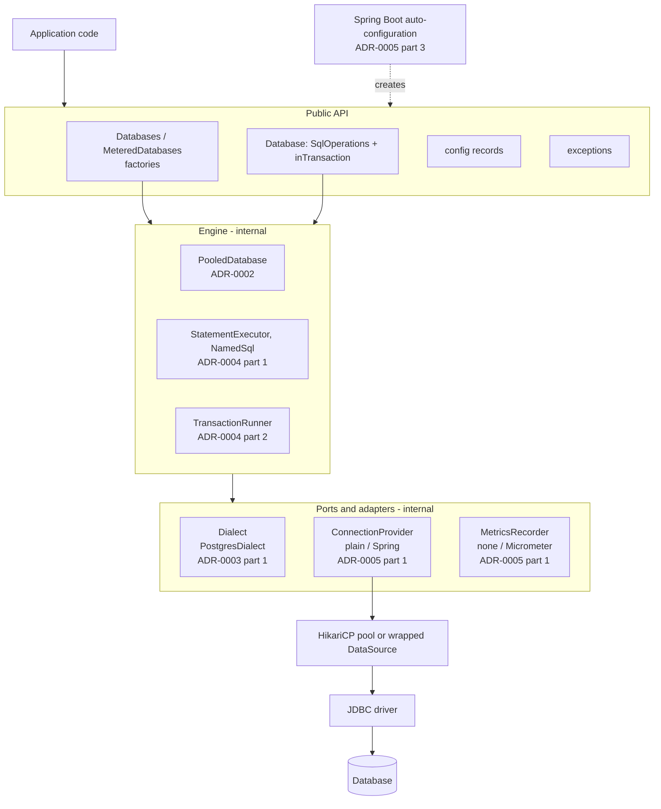

# plugkit-db architecture decisions

Five ADRs, one per question. Each is split into numbered parts with their own context, decision,
structure and consequences. Start with [ADR-0001](0001-architecture-and-structure.md) for the overall
layout and [ADR-0005 part 1](0005-integrations.md#1-integration-adapters-and-factories) for how the
pieces plug together.

| ADR | Question | Parts |
|---|---|---|
| [0001 Architecture and structure](0001-architecture-and-structure.md) | How is the library packaged and organised, and how is that kept? | 1. Recording decisions · 2. One artifact with optional integrations · 3. Feature packages with a private `internal` tree · 4. Testing strategy · 5. Shared `plugkit-core` module |
| [0002 Connections, configuration and lifecycle](0002-connections-configuration-and-lifecycle.md) | How is a `Database` created, configured and shut down? | 1. DataSource-first connections · 2. Configuration model · 3. Graceful shutdown |
| [0003 Multi-database support](0003-multi-database-support.md) | How do databases plug in, and how do their errors look the same? | 1. Dialect adapters and factory · 2. Vendor-neutral error model |
| [0004 Running SQL](0004-running-sql.md) | How do statements and transactions run safely? | 1. Statements and row mapping · 2. Transactions · 3. Timeouts at every layer |
| [0005 Integrations](0005-integrations.md) | How does it fit into plain Java, Micrometer and Spring Boot? | 1. Adapters and factories · 2. Logging, metrics and health · 3. Spring Boot 4 |

## Overall structure

## Deferred

| Item | Where it will be decided |
|---|---|
| Second dialect (MySQL, SQL Server), `DialectContractTest`, reporting unenforceable settings | New part of ADR-0003 |
| `@AdvisoryLock` for single-instance jobs | New part of ADR-0005 |
| Streaming large result sets | New part of ADR-0004 |
| JMH benchmarks, `japicmp` before 1.0 | New part of ADR-0001 |
